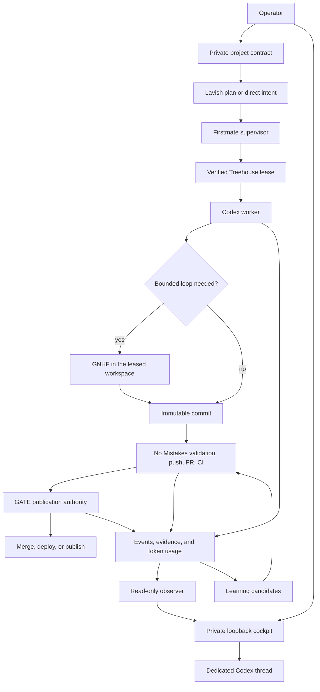
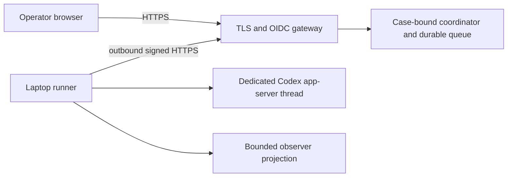
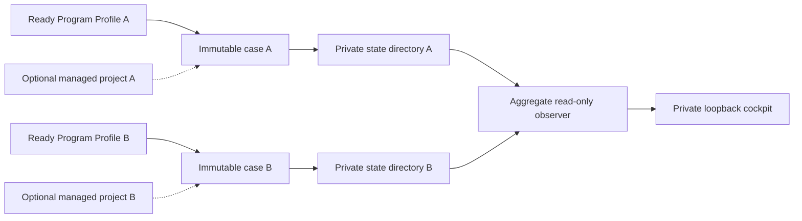
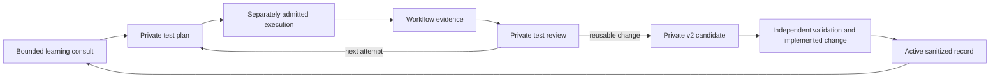

# GATE architecture

GATE is a personal, single-operator control plane for software delivery and evidence-led security work. It composes pinned upstream tools and adds only the coordination that those tools do not provide: a shared policy model, a private project registry, immutable per-program cases, a reviewed managed-tool runtime, a project-bound offline-analysis lane, a verified Treehouse lease bridge, a read-only observer, local and remote interactive cockpit paths, a static public preview, a publication authority, an active-security authority, and durable learning. This document describes the target architecture; [README.md](../README.md#current-limits) identifies which v0.2 paths are wired today.

The version-controlled repository contains the reusable distribution. Live sessions, target details, raw evidence, credential references, and private learning stay outside Git under `GATE_HOME`. Credential values should remain in an OS secret store or narrowly permissioned file outside broad agent-writable roots.

## Design constraints

- The laptop is the default execution environment.
- Concurrent bug-program work uses separate case state directories with immutable scope bindings.
- Remote cockpit delivery uses one case-bound coordinator and one outbound laptop runner per instance; the public Pages preview never becomes its transport. The reviewed systemd and Cloudflare bundles support exactly one case per VPS because every coordinator instance would otherwise share the `gate-remote` UID and could cross case-file boundaries. Concurrent remote cases use separate VPSes. The runner owns a separate dedicated conversation-only thread whose local filesystem, shell, image, skill, worktree, workspace-dependency, and unified-execution tools are disabled.
- Codex CLI is the primary runtime harness. Firstmate does not currently support Codex App as a runtime backend.
- A person must be able to bootstrap, inspect, start, stop, and reset GATE without an AI.
- Upstream projects remain pinned dependencies. GATE does not combine their source trees.
- Each state transition has one owner.
- Local-artifact authority never implies authority to contact the artifact's publisher or an endpoint extracted from it.
- Active target contact follows a reviewed, digest-bound engagement plan.
- Every claim distinguishes observation, inference, and what remains unverified.
- Every persistent lesson records the cause and the resulting change.
- Missing token data is shown as unavailable; estimates are labeled.

## Control flow

Remote interaction follows a separate authenticated delivery path while Codex and GATE execution stay on the laptop:

The coordinator never connects inbound to the laptop. The runner leases bounded conversation commands and uploads only the remote protocol projection; it does not forward raw execution state or attach to the current chat. It has no repository or active-target execution path. See [Remote cockpit bridge](remote-cockpit.md).

Concurrent bug-program work is partitioned before operational records are written:

Security work begins with separate offline and active-authority paths:

```mermaid
flowchart LR
    P[Registered project] --> S[Private artifact snapshot]
    S --> Z[Fixed zero-network REA adapter]
    Z --> I[Offline observations and hypotheses]
    I --> R[Plan and coverage map]
    R --> Q[No Mistakes plan review]
    Q --> U[Operator sees and approves exact digest]
    U --> B[GATE engagement broker]
    B --> M{Execution lane}
    K[Reviewed managed runtime] --> M
    M -->|reviewed adapter| X[In-scope tools]
    M -->|one-shot confirmed manifest| X
    U -->|one-time exact dedicated-lab authority| LA[Single-use lab job capabilities]
    LA -->|exact capability-bound manifests| M
    X --> E[Private evidence]
    E --> REA[REA analysis]
    REA --> D[Validated report and retest]
    D --> L[Learning candidates]
```

The offline branch is bound to a project contract and local snapshot rather than an engagement receipt. It cannot promote an observation into target contact. Changing a target, action class, permitted tool, execution environment, exclusion, data destination, or limit invalidates an active receipt. A reviewed adapter may continue inside the approved envelope according to its contract. The v0.2 generic lane accepts only `scope.environment: host` with receipt-approved `gate-home` because raw evidence always lands there. It creates an expiring one-shot manifest for one target, declared action label, permitted tool, catalog risk class, allowed destination set, exact argument array, executable descriptor, and set of bounds, then requires a second exact operator confirmation that acknowledges its unavailable controls. A confirmed `LabCampaignAuthority` is the only standing-confirmation lane: for one `authorization.basis=dedicated-lab` engagement it converts the operator's exact one-time authority confirmation into single-use, capability-bound `httpx-url-fetch` manifests under an immutable origin, path prefix, frozen IP set, workflow attempt, runtime, cumulative envelope, expiry, and stops. Its campaign grant remains scheduling authority only. The complete sequence and handoff rules are mapped in the [end-to-end penetration-testing workflow](pentest-workflow.md).

## Ownership

| Component | Owns | Does not own |
|---|---|---|
| GATE objective router | Deterministic selection of one reviewed categorical route, evidence plan, capability set, bounded planning actions, and unresolved choices | Raw objective persistence, ownership or access proof, specialist intake state, dispatch, target authority, or execution |
| GATE project registry | Private validated project contracts and canonical repository identity | Repository checkout, task dispatch, authorization, or policy-wide enforcement |
| GATE case registry | Immutable binding of one ready Program Profile and an optional managed project to one private state directory | Process, credential, host, or network isolation; target authority; mutation of the bound records |
| Firstmate | Intake, supervisor state, dispatch, decision inbox | Worktree lifecycle, target authorization, publication |
| Treehouse | Development workspace allocation, durable leases, and its versioned state format | Orchestration, safe destructive cleanup, or security isolation |
| GNHF | A bounded iterative task inside one exclusive lease | Worktree creation, push, PR, or policy |
| No Mistakes | Handoff, rebase, review, tests, documentation, lint, push, PR, CI | Merge, deployment, target authorization, arbitrary tool execution |
| GATE publication authority | Read-only exact-head and observed-check preflight in v0.2; trusted mutation adapters in the target design | Editing or reviewing the change |
| GATE engagement broker | Plan receipt, target/action-label/tool/environment preflight, one-shot generic manifests, supervised execution, stop/revocation, reviewed adapter admission, and exact capability-bound lab manifests | Creating its own authorization, treating a campaign grant as execution authority, interpreting arbitrary argv as an action proof, or launching an unbound command |
| Lab campaign authority | One confirmed dedicated-lab HTTP origin/path-prefix window, observed frozen destinations, cumulative ceilings, single-use job capabilities, adaptive enqueue permits, private request metrics, stop, and conservative recovery | General production authority, free crawling, result-driven test invention, high-impact actions, or bypassing the engagement and workflow contracts |
| GATE managed tool runtime | Exact GitHub-release lock validation, private artifact cache, staged install, zero-egress smoke, current-byte verification, removal, and lifecycle results | Target authority, argument semantics, data-pack admission, privilege brokering, or execution outside a separately approved lane |
| GATE offline-analysis lane | Project/artifact/runtime binding, private snapshots, one-shot confirmation, zero-network launch, and bounded evidence for the fixed REA adapter | Target contact, arbitrary REA commands, artifact execution, or authorization inferred from artifact contents |
| REA | Analysis of binaries, artifacts, saved captures, and runtime evidence | Traffic acquisition or active target operations |
| AXI | Agent-facing command and output conventions | Trust, policy, or orchestration |
| Skills CLI | Installation and synchronization of reviewed skills | Deciding whether a skill is trustworthy |
| Lavish | A local interactive plan or decision artifact | Continuous operations monitoring |
| Program Profile browser wizard | One private profile's typed, choice-first intake, source review, and reviewed recommendation application over an ephemeral loopback session | Target contact, authority inference, attestation inference, or aggregate fleet monitoring |
| Observer | Read-only compact campaign fleet, one selected structured detail, setup progress, GATE activity, derived agent/task, learning, status, and token views | Execution, Program Profile editing, or an interactive terminal session |
| Local cockpit companion | One capability-protected loopback operator surface, one dedicated Codex app-server thread, bounded user-visible conversation and questions, categorical activity, and a separate observer fleet projection | Hidden reasoning, raw commands or output, target authority, Program Profile private capture, public serving, or attachment to an arbitrary existing Codex thread |
| Remote cockpit coordinator | One authenticated operator/case/session binding, durable command queue, secure browser session, event replay, bounded runner projections, root-protected production configuration, and service-writable SQLite state | Laptop ingress, Codex credentials, raw operations or evidence, Pages interaction, execution authority, attachment to this cloud chat, or multiple cases on one reviewed VPS bundle |
| Remote cockpit runner | One outbound Ed25519-authenticated coordinator connection, owner-only replay journal, and one dedicated conversation-only Codex app-server thread with local execution tools disabled | Browser identity, public serving, repository execution, active target execution, `GATE_HOME` access, or dispatch of an unleased or digest-mismatched command |
| Public cockpit | One static Pages preview assembled from an explicit file allowlist and opaque checked-in sample data | Local observer access, interaction, session capabilities, live campaign claims, or private runtime data |
| Learning pipeline | Correction capture and validated memory changes | Expanding authorization or releasing data |

No Mistakes deliberately stops when a PR is ready. In v0.2, the publication authority can only inspect PR state, exact head, mergeability, and the complete bounded set of checks observed on that head. Branch protection is not required. A future mutation adapter must verify a No Mistakes attestation bound to that head before it can merge, deploy, or publish. GATE never reports that upstream No Mistakes performed those actions.

## State and data boundaries

Tracked repository content:

- schemas, policies, templates, and configuration defaults;
- reviewed project-scoped skills and exact upstream and managed-tool dependency locks;
- sanitized repository-wide lessons;
- documentation, adapters, and the public-safe cockpit source and preview fixture.

Private runtime content under `GATE_HOME`:

- immutable case scopes and separate per-case operational state directories;
- `events.jsonl` and `tokens.jsonl`;
- engagement plans, authorization evidence, receipts, active and offline one-shot manifests and claims, offline input snapshots, run metadata, sandboxes, and audit trails;
- registered project contracts, including repository and delivery references;
- raw captures, binaries, screenshots, recordings, and tool output;
- private learning records;
- upstream checkouts, content-addressed managed-tool archives, staging trees, installed tool executables and receipts, private clone-bound and task-bound Treehouse roots, process state, and logs.

The remote coordinator adds a separate deployment trust domain outside Git: an owner-only service-writable SQLite directory, separate root-protected configuration and runner enrollment, plus in-memory browser sessions that are revoked by a service restart. `gate remote init` prepares an owner-only local case bundle and Ed25519 enrollment; `gate remote doctor` checks local integrity and prerequisites without claiming that the external gateway or round trip is live. The laptop runner keeps its private key and deduplication journal owner-only outside the repository. Only the public runner key is enrolled with the coordinator. Remote records contain bounded queued operator text, final visible replies, questions, lifecycle events, fleet/activity projections, and binding identifiers. Automatic fleet/activity data and structural state fields exclude raw evidence, dedicated target fields, raw commands and output, paths, credentials, hidden reasoning, and internal thread IDs. Operator messages, final visible replies, and rendered native questions can still mention URLs, project, target, or command context and therefore keep the coordinator database inside the sensitive-data boundary.

The default is `$HOME/.local/share/gate`. `GATE_HOME` overrides it. Machine-specific settings may be placed at `$HOME/.config/gate/config.json`; v0.2 has a merge helper for that file but most commands do not yet load a complete merged provider/profile configuration. The target precedence is repository defaults, selected profile, local override, then explicit command-line arguments.

Tracked secrets may appear only as `env://`, `keychain://`, or `file://` references. v0.2 validates those shapes and redacts recognized sensitive text in supported event paths, but it has no general secret resolver or data-flow policy engine. Keep credential values in an OS secret store or narrowly permissioned file outside broad agent-writable roots.

`GATE_HOME` is one local trust domain for case scopes, project configuration, offline-analysis provenance, engagement authority, active-execution provenance, private evidence, and managed installations in v0.2. Per-case directories prevent accidental cross-program state lookup, but a process that can rewrite the whole root can change every case and the local configuration or history it describes, including snapshots, manifests, claims, unsigned receipts, runs, stops, and evidence. Exclusive files and hashes coordinate trusted processes rather than protecting state from that same-user writer. Managed installation receipts are evidence only. Full npm verification reconstructs a clean tree from the repository-tracked dependency lock and integrity cache, release-upstream verification checks bytes against the reviewed upstream lock, and managed-tool verification checks the catalog-entry digest, runtime-lock entry, exact installed tree, current executable bytes, and zero-egress smoke. Reconstruction invokes the npm CLI contained by the real installation of the running Node executable through that exact Node path and a minimal environment with empty explicit user/global npm configs; it does not resolve npm from `PATH` or inherit `NODE_OPTIONS`. Source verification likewise resolves a fixed locked-down system Git and supplies only a controlled command path and Git environment. A writer limited to `GATE_HOME` cannot re-anchor altered upstream or managed-tool bytes without also changing the reviewed repository lock or catalog. Whole-root write access still belongs only to trusted operator processes.

### Objective routing boundary

`gate objective recommend --proposal FILE --json` accepts one regular, non-symlink categorical proposal of at most 64 KiB. On POSIX and WSL2 it requires current-user ownership and exact mode `0600`; native Windows ACL ownership is not verified. The proposal is bound to the canonical SHA-256 of the exact checked-in objective route catalog. Its schema provides no dedicated field for the raw objective, exact targets, accounts, contacts, URLs, private paths, credentials, source bodies, commands, or arguments. Producers must also generate opaque handles and references randomly rather than encode private values into them. Repository validation checks the catalog schema, route closure, registered basis and choice references, and route-listed tool IDs against the security-tool catalog.

The resolver is pure and deterministic. It selects the highest-priority matching route independent of catalog order and emits a bounded recommendation with a domain-separated projection of the caller handle, canonical millisecond timestamp, and category-level provenance counts. Unknown or mixed work receives a clarification or decomposition route. Registered questions preserve explicit, recommended, and unresolved states; manual ownership, access, project, artifact, system-scope, and external-action decisions cannot be inferred. Action preconditions name the exact accepted choices, so an explicit blocking answer cannot accidentally make an action ready.

The result is a planning handoff with `executionAuthority: false`. It does not persist an objective, resolve opaque source references, consult private learning, inspect runtime tool state, dispatch Firstmate, create a Program Profile or case, contact a target, send a message, or operate a system. The selected domain owner must establish each of those capabilities through its own contract.

### Project registry boundary

`gate project register` imports a bounded regular non-symlink JSON source, validates it with [project.schema.json](../schemas/project.schema.json), canonicalizes its repository identity, checks the default branch and referenced profiles, and writes an owner-only canonical record under `GATE_HOME/projects`. Both imported and canonical stored UTF-8 representations must fit the registry byte ceiling. Local `file://` locators are normalized to their physical realpath and must continue to resolve there during later loads. A serialized writer lock prevents concurrent replacement. The registry accepts an identical registration idempotently and rejects changed content for an existing ID or a second ID for the same case-normalized forge repository. Registration writes `.registry.pending` before publishing the contract and removes it only after the transaction-bound private audit event is flushed. A contract-write failure rolls back the exact record when safe. An audit append, flush, or close error preserves both contract and marker because the event outcome is ambiguous; an abrupt interruption leaves the same fail-closed state. The marker binds the project ID, event ID, random transaction nonce, and SHA-256 of the canonical contract to the event evidence reference. While either the lock or pending marker exists, full reads fail or return invalid/degraded status rather than treating the transaction as complete.

`project show` is the explicit full-contract read. `project list`, general status, and the observer use summaries that omit repository URLs and deployment destinations; the observer replaces the project ID with a process-local keyed pseudonym. Invalid and unexpected entries remain visible as invalid. v0.2 has no update or delete transition, and the registry is not a source of security authorization.

The registry does not yet dispatch Firstmate, clone a repository, select a project implicitly, bind a Treehouse repository path to a registered identity, or make publication and deployment adapters enforce every delivery field. Those transitions require narrow owner bridges rather than treating schema validity as runtime enforcement.

### Case isolation boundary

`gate case create ID --program PROFILE --name NAME [--project ID]` creates `GATE_HOME/cases/ID/scope.json` and `GATE_HOME/cases/ID/state`. The scope captures the exact current ready Program Profile digest and, when supplied, the exact current managed-project digest. It also records the implemented isolation posture: `stateNamespace: isolated-directory`, `processBoundary: shared-user`, and `networkBoundary: adapter-dependent`. The scope is immutable. There is no update or delete transition, and a changed profile or project digest makes the case stale.

Target-specific Program Profiles and project contracts remain in their shared private registries under the root; managed tools, upstreams, and public learning are shared there as well. A selected case redirects campaign execution observations and operational state—events, engagements, workflows, execution and offline-analysis records, evidence, canonical token records, and private learning—to its own `state` directory. `gate --case ID COMMAND` and `GATE_CASE=ID gate COMMAND` select that namespace; conflicting selectors fail. Every engagement and workflow command, Program Profile compilation, and offline-analysis manifest, run, purge, or status operation requires an explicit runtime selector. Leading `--unassigned` selects the writable base-state compatibility namespace, can create new unscoped records, and opts out of case attribution and separation. GATE never selects it implicitly, so a case is the normal program-work selection. Profile compilation checks the bound Program Profile, and offline analysis checks the bound project.

Strict case commands re-read the immutable scope, state-root marker, and current shared bindings immediately before dispatch. Compilation also carries the case's expected Program Profile digest into both the locked profile read and the locked artifact-publication check. Offline manifest creation carries the expected project-contract digest through its initial read, post-snapshot preflight, and final publication preflight. The project registry has no update or delete operation, so trusted registry writers cannot revise a registered ID; a changed same-user file is still detected by those reads. Other case-state mutations use dispatch-time binding freshness plus the immutable scope and state marker for attribution. They do not hold the shared profile registry lock for the complete operation, so a concurrent profile revision can make a case stale immediately after dispatch; the in-flight record remains attributed to the sealed case scope and the next strict command fails. A same-user process that can rewrite `GATE_HOME` between a final check and a write remains outside this coordination boundary.

Setup and shared-registry routes reject `--case`, `GATE_CASE`, and `--unassigned`; these include bootstrap, validation, doctor, cases, projects, workspaces, upstreams, tools, publication, Program Profile intake and inspection, and the host-wide analysis capability check. `gate up` also rejects all selectors because it builds the bounded aggregate fleet view from the base runtime. Plain `gate status` reports that aggregate, `gate --unassigned status` reports only base state, and selected status reports one case plus its binding health. Sanitized events and private learning remain available without a selector; writes then use the same base state. `learn promote` is the deliberate reviewed bridge from a selected case's private candidate into shared public learning.

This boundary isolates state layout, not execution. Every case process retains the operator's user identity and host access. Cases share the kernel, host network, available credentials, managed tool installations, and any other same-user resources. Only an admitted adapter or execution environment can add process or network containment, and its exact guarantees remain authoritative.

The case registry considers at most 1,024 directory entries and projects at most 32 cases, reports lower-bound omissions and invalid entries in scan metadata, and keeps stale cases visible without treating their runtime as ready. `complete: false` means the cockpit is not a complete fleet view. There is no fleet pagination in v0.2; a known omitted case remains directly retrievable with `gate case show ID --json` and `gate --case ID status --summary --json`. An unassigned `GATE_HOME` that resolves to a case state root or descendant is rejected before writes, including through parent-directory aliases; direct same-user access to that directory remains outside this selector boundary. The observer pseudonymizes case, Program Profile, and project IDs before the browser boundary. A case row and its selected detail receive only the same allowlisted lifecycle projection used by the rest of the observer; apart from the operator-controlled case display name, they never receive raw PTY data, stdout or stderr, argv, commands, target selectors, evidence bodies, or private paths.

## Execution environments

Host execution is the default because the operator has authorized laptop use and several security tools need a GUI, browser certificate store, raw host capture, USB or ADB, a GPU, or a physical network interface.

The remote coordinator can run from an exact reviewed commit installed as a root-owned, read-only VPS release with atomic release-link activation, loopback readiness checking, and link rollback under unchanged host dependencies. The manual immutable installer accepts only the commit, archive digest, and installer digest recorded in a protected root-owned authorization file. Production configuration and the runner public key are protected `root:gate-remote` read-only files under `/etc/gate-remote/CASE`; only SQLite state under `/var/lib/gate-remote/CASE` is service-writable. Those absolute, normalized, non-root roots cannot overlap. Units, configuration, runtimes, gateway files, and forced-interruption recovery are outside the release-link transaction and remain administrator-managed. The provider-neutral scaffold and optional Cloudflare Tunnel/Access route bundle are deployable templates rather than hosting, and both support exactly one case per VPS because multiple instances would share the service UID. Concurrent cases require separate VPSes. DNS, TLS/OIDC policy, host state, credentials, and runner enrollment remain operator-owned. The laptop runner uses a separate dedicated conversation-only Codex thread with local filesystem and execution tools disabled. It does not relay active target execution.

The offline-analysis lane is a distinct Linux/WSL2 execution environment for one fixed operation. Manifest creation copies an exact absolute regular file into private state, hashes it, and binds its bytes and source identity to the current canonical project-contract digest. It also binds the reviewed `rea-stable` version, full source commit, npm integrity and lock digest; the observed SHA-256 and file identity of Bubblewrap, Node, the GATE adapter, and the REA entrypoint; fixed environment, mounts, and arguments; private evidence paths; a wall-duration bound; and zero requests, request rate, and model tokens. The manifest expires after at most 15 minutes and a durable claim consumes it before spawn.

The cheap capability path confirms prerequisite file presence and launches `/usr/bin/true` through the actual minimal Bubblewrap namespace shape. It does not reconstruct or hash the full managed REA npm tree. Manifest creation performs the reviewed-lock reconstruction, observes the Bubblewrap, Node, adapter, and REA entrypoint hashes and filesystem identities, and stores those bindings. Execution repeats the full upstream reconstruction and runtime identity checks before invoking Bubblewrap through its already-open descriptor. Bubblewrap creates fresh user, PID, network, IPC, and UTS namespaces, requests a cgroup namespace where supported, disables nested user namespaces, drops all capabilities, clears the environment, mounts `/usr` and every runtime/input descriptor read-only, and gives the process private temporary directories. The fixed adapter invokes only REA `inspect-pe-resources`; it never executes the supplied PE. Successful output must attest that the namespace exposes only loopback, has no IPv4 routes, has zero inherited, permitted, effective, bounding, and ambient capabilities, and has `NoNewPrivs`. This does not provide CPU or memory quotas, an immutable same-UID snapshot of the managed REA tree, protection from another same-UID writer to `GATE_HOME`, or syscall-level denial of Unix sockets. The capability probe proves only that the minimal namespace launched at that time; a completed adapter run supplies the bound in-namespace observations.

The managed tool runtime turns seven catalog entries into exact private installations without changing target authority. [`tool-runtimes.lock.json`](../locks/tool-runtimes.lock.json) binds the exact catalog-entry digest, version, full source commit, release evidence, artifact identity, URL, size, archive and executable SHA-256, exact archive members, executable path, platform, and bounded smoke. The 28 artifacts cover Linux and macOS on x64 and ARM64. All observed releases were marked non-immutable by GitHub; six ProjectDiscovery source commits carried provider verification, while the FFUF source commit did not. GATE therefore treats the reviewed hashes and exact release identities as the byte anchors rather than claiming signed or immutable provider releases.

`prefetch` stores the size- and digest-verified archive under the private content-addressed cache. `install` rechecks those bytes, rejects unsafe, linked, duplicate, case-colliding, missing, or extra archive members, extracts only the locked executable, and creates an exact private staging tree. On Linux/WSL2 it invokes protected system Bubblewrap directly with no shell, creates a fresh zero-network namespace, and applies `prlimit` inside the new user/PID namespace before running only the locked version smoke. The smoke bounds wall time, output, process count, and network access, but does not independently cap memory, open file descriptors, or file size beyond private temporary filesystems and host limits. A passing staged tree is atomically promoted as one executable plus its receipt, with atomic rollback on publication failure. `verify` checks the repository lock and catalog binding, exact installed tree, current executable bytes, receipt evidence, and a new smoke whose output digest must match installation. `remove` atomically retires the runtime from its active path and retains the content-addressed archive, whose next reuse verifies exact bytes; restoration after a deletion failure is best effort. Mutation serialization and crash recovery follow the [managed-runtime recovery contract](security-tooling.md#managed-core-runtime). macOS artifacts are prefetch-only until an equivalent zero-egress smoke supervisor exists; native Windows has no locked artifact.

Lifecycle results state that installation grants no authority. Three reviewed workflow-phase adapters admit only DNSx 1.3.1 exact-domain A observation, HTTPx 1.12.0 metadata-only exact-URL GET observation, and HTTPx bounded exact-URL GET/HEAD fetch after current-byte and live-smoke verification. The fetch adapter retains a private response representation only for GET and returns body-free metrics. The remaining five runtimes and every broader operation remain invocation-blocked. `naabu` additionally needs a reviewed raw-network privilege adapter, and `nuclei` additionally needs admission of exact templates. Inventory and observation use receipt evidence rather than execution admission; the [managed-runtime verification boundary](security-tooling.md#managed-core-runtime) defines which commands check current bytes and rerun live smoke.

The supervised generic lane runs only on Linux or WSL2 and accepts only engagements approved for `scope.environment: host` and the `gate-home` evidence destination. It is a process-control and evidence boundary rather than a sandbox; container, rootless-container, VM, and remote-lab receipts require another lane that creates the named environment. It resolves a permitted catalog command only when its `commandIdentity.genericLaneAdmission` allows `path-discovery`. A `reviewed-admission` PATH entry may expose a candidate for diagnostics, but its readiness is `identity-unverified`; GATE withholds that candidate as the executable and blocks generic and broad capability. A verified managed runtime takes precedence over every PATH namesake but is also withheld from the generic lane pending workflow-phase admission; GATE does not fall back to the ambient command. This prevents an ambiguous `httpx` command from identifying the wrong product and prevents the fixed REA adapter from admitting REA's broader A2 surface.

For an eligible PATH command, GATE opens and hashes its regular executable, rechecks descriptor metadata immediately before spawn, and launches the still-open descriptor through `/proc/self/fd` with `shell: false`, an empty stdin, a minimal fixed environment, a private working directory, and bounded private output files. Known-good executable provenance remains unavailable for this PATH-only lane. While the original supervisor remains alive, a fresh process group supports best-effort wall-duration, revocation, stop, `SIGTERM`, and `SIGKILL` handling. A supervisor crash or `SIGKILL` has no takeover path and can leave that ordinary tool process group alive. The child retains the same UID and host authority. A same-UID writer can mutate a writable executable inode before or during exec, so the observed descriptor digest is not an immutable launched snapshot. Same-user access, interpreters, dynamic libraries, plug-ins, configuration, input files, children, and escaped daemons remain outside that digest.

Pinned rootless OCI profiles are the target design for conflicting or heavy command-line tools; v0.2 does not ship those profiles. They will organize dependencies and will not be treated as a security boundary for hostile code. A broader Kali container can provide compatibility after a pinned image and SBOM exist, while purpose-specific packs remain the reproducible source of truth. A VM is optional and should be introduced only after its setup, start, smoke-test, reset, and stop flow is repeatable without an AI.

Treehouse worktrees provide change isolation. They do not isolate processes, credentials, networks, caches, the kernel, or the host filesystem. Worktrees from one clone also share the common `.git`: unknown or hostile same-user code can mutate hooks, configuration, objects, and refs outside its worktree. Such code requires a standalone clone or an OS sandbox.

The v0.2 workspace bridge runs only on Linux or WSL2 and implements three GATE operations: lease, aggregate status, and nonmutating verification. Before every operation it requires the managed Treehouse 3.1.3 executable to be `integrityState: verified` and selects a fixed trusted system Git. Lease acquisition is the only Treehouse subprocess: `treehouse get --lease --json --no-fetch --branch BRANCH --lease-holder HOLDER [--base BASE]`, with update checks and interaction disabled. Omitting `--base` leaves base selection to repository Treehouse configuration. GATE never invokes Treehouse `status`, `return`, `destroy`, `prune`, or `enter`. Treehouse and Git receive a constructed minimal environment with an empty private home and private temporary directory. Inherited credentials, proxies, SSH agents, language loaders, and general session variables are absent.

Private Treehouse state is partitioned first by a binding to the physical main clone and then by a SHA-256 task-ID root. A lease creates its task root exclusively; an existing root burns that task ID and is never reused. Fresh task IDs therefore allocate fresh roots. Each physical clone has a lifetime ceiling of 511 retained task roots. Capacity recovery requires a new physical clone or future mount-safe upstream lifecycle support, never deletion or reuse of a retained root.

GATE status and verification never query Treehouse. They stable-read the clone and task bindings, exact version-4 state with one healthy lease, and exact 32-byte owner-only state key. The bridge verifies the seed-inventory HMAC and binds SHA-256 of the raw state and key bytes into the immutable completed receipt. The HMAC covers only the seed inventory; lease evidence also depends on the trusted `get` receipt and immutable raw-file digests. Treehouse 3.1.3 status recovery can move user files, so treating it as a read-only query is unsafe.

Lease always uses Treehouse `--no-fetch`; GATE also disables Git lazy fetch and every transport. Any requested branch, base, object, or blob must already be local. Acquiring or refreshing refs is a separate reviewed network workflow because the bridge supplies no credential, proxy, SSH, or network broker. Before and after Treehouse execution, GATE accepts only a narrow reviewed allowlist of shared repository-local and per-worktree configuration keys with validated values; every unreviewed key fails closed. This excludes includes, filters, diff/merge drivers, credential and SSH commands, editors, pagers, external protocols, worktree redirection, commit graphs, and weakened stat behavior. Git LFS filters are blocked until a reviewed integration exists. Separate inspections cannot exclude a concurrent same-user writer to the shared Git directory.

Before acquisition, GATE durably writes a `pending` lease binding. After `get`, it checks the returned base, path, lease ID, holder, timestamp, and branch against the direct state read and requires the path to remain within the bound private task root. Before reporting success it rejects Git operation and transaction locks, submodules, nested Git metadata, hidden or staged real-index state, corrupt or altered object graphs, and unreachable objects. It builds a controlled checkout of exact `HEAD` with a private fresh index and compares file types, modes, links, symlinks, paths, and bytes against the real workspace under bounded entry, byte, and time limits. Extra and ignored workspace paths fail. GATE then persists the durable `workspace.leased` event and atomically replaces `pending` with a `complete` binding containing the event receipt and immutable state/key digests, followed by another state read. Treehouse persists the lease beyond the GATE process; interruption leaves a retained pending or unbound lease that aggregate status reports as unverified.

`workspace verify` repeats the lease and repository identity checks without mutating Treehouse. The supplied repository must be the main worktree, both worktrees must share one common Git directory, and the landed-ref name must equal the branch checked out in the main worktree. Verification rejects active processes, in-progress operations, submodules, nested metadata, grafts, alternates, replacement refs, altered or unreachable objects, hidden or staged index state, and any leased-workspace bytes outside the exact current `HEAD`. Ignored cache paths are allowed only in the main worktree. After rechecking object integrity, it proves that the exact workspace `HEAD` is an ancestor of `refs/heads/BRANCH`. This establishes local reachability only; it is not provider, No Mistakes, or publication proof. The command records `workspace.verified` and retains the durable lease.

Automatic return, reset, destruction, and slot reuse are disabled. Reproduced Treehouse 3.1.3 bind-mount races can cause destructive cleanup to alter or delete host data, and the upstream release exposes no primitive that can make that transition safe. Operators and agents must never invoke any Treehouse command directly against a GATE root, including status. Each retained lease and one-shot task root consumes disk. Cleanup remains a future mount-safe upstream integration; GATE does not claim a power-loss durability guarantee.

Workspace operations are serialized by an owner-only clone-specific lock. When aggregate status reports `operation-lock-present`, it has inspected no task or Git state. Manual clearance must prove no GATE operation or related Treehouse/Git child remains, reject malformed or unsafe lock metadata, treat a live `/proc/PID` as non-removable even after PID reuse or reboot, revalidate the exact lock's device, inode, metadata, and content immediately before unlinking only that file, and rerun GATE status before mutation. The ordered procedure is in [the operating model](operating-model.md#operation-lock-recovery).

## Code lifecycle

1. The operator registers and verifies the private project contract; Firstmate records intent, acceptance criteria, risk, delivery mode, and merge posture outside GATE's current bridge.
2. GATE invokes the verified Treehouse bridge, which grants a fresh exclusive durable lease and returns its checked identity.
3. Codex works inside the lease using reviewed skills and admitted tools.
4. GNHF may run only as a bounded leaf task in that lease. Iteration, time, token, and failure caps are mandatory.
5. The worker hands an immutable commit to No Mistakes.
6. No Mistakes owns review through green CI. No other reviewer or publisher mutates the same branch during this stage.
7. The v0.2 publication authority performs a read-only exact-head and observed-check preflight without depending on branch protection. A future trusted adapter verifies the external No Mistakes attestation and project policy before any merge, deployment, or publication.
8. The observer records available GATE state. GATE verifies that the exact clean, inactive workspace head is locally reachable from the named checked-out branch, then retains the lease for manual reconciliation.

Only the project registry and Treehouse lease/status/verify portions of this lifecycle are newly wired. GATE still does not invoke Firstmate, launch Codex or GNHF, hand a branch to No Mistakes, verify No Mistakes attestations, land a change, safely destroy a Treehouse root, or perform publication mutation.

## Security lifecycle

Passive public research, local static analysis, hypothesis generation, and saved-evidence analysis can proceed without an engagement receipt under their data and provider rules. Network probes, interception, authentication, fuzzing, exploitation, persistence, destructive tests, denial-of-service tests, or data removal require a valid receipt.

The implemented local-static path accepts a lawfully supplied artifact only. A proprietary client or other proprietary binary remains private under `GATE_HOME`; possession and offline-analysis authority do not authorize downloading it, contacting the vendor, resolving or connecting to embedded endpoints, using accounts, testing updates, or interacting with third-party services. Manifest creation binds the input to a registered project for provenance, but the registry is not target authority. Endpoint strings become unverified hypotheses. Moving any hypothesis into passive-provider retrieval or live target contact follows the explicit `local-to-network-hypothesis` handoff in the [end-to-end workflow](pentest-workflow.md), including independent ownership resolution and a separately reviewed active engagement when contact is proposed.

Offline snapshot retention has fixed ceilings of 64 artifacts and 2 GiB. Snapshot admission, execution claim, and explicit digest-bound purge share one private lock. A durable creation intent lets the next lock holder distinguish and remove an incomplete snapshot from one protected by a durably published manifest. Purge deletes only the bound snapshot after an abandoned, expired, or terminal transition and preserves lifecycle records and evidence. Aggregate evidence retention is a separate unresolved storage bound.

An engagement contains:

- authorization basis, evidence, and validity window;
- precise included and excluded selectors;
- permitted action classes, permitted catalog tool IDs, and execution environment;
- hypotheses, depth, commands, coverage, and completion tests;
- request, rate, concurrency, duration, and token limits;
- data destinations, retention, and secret references;
- stop conditions;
- No Mistakes review evidence and an operator receipt for the exact plan digest.

The broker checks the receipt for an exact target and declared action label and returns a digest binding to that decision, including the execution environment and permitted tool IDs. The label is authorization metadata, not validation that arbitrary argv has the same semantics. Operator and No Mistakes provenance remains `local-unverified`: their identifiers are locally recorded rather than externally attested. Scope expansion requires a new plan and receipt.

Active execution has two broker lanes. A reviewed tool-specific adapter validates its own typed operation, fixed flags, and tool-aware limits. DNSx and HTTPx provide the first three managed examples; each binds the canonical adapter registry, compiler, runtime lock, catalog entry, executable digest, engagement, workflow phase attempt, admission, resource reservation, and current journal head. The supervised generic lane admits a catalog-discovered, PATH-eligible executable on Linux or WSL2 for one host launch only and requires receipt-approved `gate-home` because raw evidence always lands there. Generic manifest creation requires exactly one whole-argument `{{GATE_TARGET}}` placeholder and binds the expanded argument array, target argument index, target selector, declared action label, permitted tool and catalog risk class, engagement plan/envelope/receipt hashes, host environment, allowed destinations, authorization expiry, executable descriptor metadata and observed SHA-256, declared bounds, private evidence paths, and expiry. Ordinary executions in both broker lanes require the literal `EXECUTE MANIFEST_ID MANIFEST_SHA256 UNMETERED` confirmation. A confirmed [dedicated-lab campaign authority](lab-campaign-authority.md) may supply that literal internally only for one durably claimed capability bound to an exact `httpx-url-fetch` manifest. The authority does not create a third broker lane or relax manifest checks. An exclusive claim is durable before spawn, so the manifest cannot be replayed even when launch or supervision fails.

The generic lane enforces engagement and host-environment binding, receipt-bound allowed destinations including `gate-home`, target-argument binding, `declared-action-label-binding`, tool allowlist and catalog-risk binding, exact arguments, no-shell descriptor execution, a minimal environment, private bounded stdout and stderr, declared bounds within the receipt, `executable-descriptor-observed-sha256`, and the one-shot claim. Authorization/revocation/stop polling, wall duration, and process-group termination are best effort and require the original supervisor to remain alive. `argv-action-semantics-validation`, egress-target restriction, request count and rate measurement, tool concurrency and token measurement, daemon-escape containment, `supervisor-crash-containment`, `immutable-executable-snapshot`, filesystem isolation, credential brokering, full artifact inventory, and known-good executable provenance are unavailable and recorded as such. Durable stop and revocation files do not provide takeover supervision; a supervisor crash or force-kill can leave the original process group running, and processes can also leave that group. If authenticated group identity is lost during teardown, GATE records status `unknown` with termination reason `supervision-lost` instead of claiming termination. Arbitrary argv can exceed the declared label, so the operator reviews it and reviewed adapters remain the only lane that validates tool-specific flags. Execution events use the maximum of the declared action effect and catalog risk ceiling as a conservative audit classification; that label does not block launch. The observed SHA-256 is the bytes read through the opened descriptor. A same-UID writer can mutate a writable inode before or during exec, so the digest does not prove atomically frozen launched bytes or the runtime dependency graph. Raw `gate run`, `gate upstream exec`, and argument-taking execution shortcuts remain disabled.

The completion contract covers asset discovery, architecture, authentication, authorization, sessions, inputs, business logic, client behavior, data exposure, infrastructure, supply chain, and post-exploitation impact. Each surface should be covered or carry an explicit limitation, and empty scanner output is not sufficient. v0.2 validates these fields as data; `engagement close` is administrative and does not evaluate or certify completion.

## Evidence model

Every finding carries:

- a stable claim ID and concise statement;
- `observed`, `inferred`, or `unverified`;
- raw evidence references and hashes;
- tool, version, command, target, and timestamp;
- an independent validation or an explicit reason it was not possible;
- limitations and residual unknowns;
- impact, reproduction, remediation, and retest state.

Target output, webpages, binaries, captures, and tool responses are untrusted data. They may create a learning candidate but cannot directly change memory, policy, or authorization.

## Observation and token accounting

GATE commands append normalized events and the observer only reads state. `gate up` runs without a runtime selector, scans the bounded case and Program Profile registries, and builds one aggregate snapshot. The compact fleet table combines up to 32 valid or attention-worthy cases selected from at most 1,024 discovered case entries with up to 32 current profile setups that are not represented in the current bounded case projection. When that scan is partial, a setup row may coexist with an off-projection current case. Profile setup rows cross the browser boundary only as process-local pseudonyms, questionnaire stage and answered/total progress, blocker count, next section, readiness, update time, and fresh/stale state. Recommendation mode is nullable and crosses that boundary only when a reviewed producer supplies it. Learning counts are derived from case-backed state and remain unavailable for setup-only rows. Program names, answers, source records, contacts, targets, blocker prose, file paths, and profile digests remain private in that setup projection. The separate case projection deliberately emits the operator-controlled case display name; it otherwise omits exact target selectors and the same raw private material, so operators should not embed sensitive selectors in a case name.

The local cockpit companion runs on its own ephemeral loopback origin. Its server preloads the checked-in shell, injects a local browser client, creates independent session and CSRF capabilities, and owns one dedicated Codex app-server thread. It fetches the observer's exact loopback `/api/status` endpoint server-side and exposes a second bounded `gate.local-fleet/v2` projection only through the authenticated local session. Each fleet generation is valid for at most 15 seconds; local, remote, and browser consumers remove it at expiry while keeping an independently current conversation usable. Fleet state never becomes a Codex prompt. Operator messages and final Codex replies are bounded and filtered separately; categorical activity deliberately omits hidden reasoning, commands, arguments, output, paths, tool names, targets, evidence, credentials, thread IDs, and raw errors. Dedicated-thread notifications project exact token counters. A matching `account/usage/read` result may add an estimated USD or credit amount; only amount micros and unit cross the browser boundary. The companion has no execution-authority role and does not replace the Program Profile wizard's private capture path.

An owner-only case CTF pilot document supplies three independent verdicts: Solving, Learning, and Cockpit. Its bounded lifetime is at most 180 seconds, timestamps cannot outrun their enclosing observation, and campaign-worker publications bind to a private worker generation whose lease and liveness must remain verifiable. PASS states have mechanical evidence requirements. Learning transfer counts derive from deduplicated private receipts that bind a learning digest, applied change, validation evidence, and distinct destination task. Only the count crosses the observer boundary. The browser receives opaque case aliases, categorical stages and actions, counts, timestamps, exact resource totals when available, and a bounded latest-event category/state/time. A random fleet selection epoch binds a retained alias to one companion or runner lifetime; epoch changes clear multi-case selection. The browser never receives target or flag data, evidence references or digests, hypotheses, commands, prompts, cookies, paths, worker identity, or event prose.

The public cockpit is a separate static artifact. `cockpit/scripts/build-site.mjs` recreates `cockpit/_site` from the exact reviewed file allowlist and never copies `cockpit/companion`. The checked-in snapshot uses opaque sample aliases and `mode: "preview"`; the UI labels it `PREVIEW · NOT LIVE` and disables all writes. Observed public snapshots are not supported. Live fleet telemetry can reach only the authenticated local companion or the authenticated, case-bound remote runner and coordinator path; it never enters the static Pages artifact. GitHub Pages cannot reach the loopback observer or companion and conveys no session capability.

Selecting a row opens one structured case-activity or profile-setup detail panel; polling preserves the selection and detail state. The summary cards are exact only after an observed snapshot, when both bounded scans are available, complete, untruncated, and free of invalid entries, and every visible case has available runtime observation. With current observations, partial, truncated, or invalid coverage, or an unavailable per-case runtime, yields visible-row lower bounds with a `+` suffix. Missing or unavailable scan coverage, stale setup observations, or a failed status refresh makes the summary unavailable (`—`), rather than treating cached rows as current lower bounds. Cached rows remain visible for inspection. A failed setup scan does not reject an otherwise fresh observer snapshot; its previously projected bounded setup list may remain visible as stale while its scan metadata is unavailable and incomplete. The [parallel campaign acceptance contract](campaign-acceptance.md) defines the observable isolation, recovery, and reusable-learning checks for this view.

The activity, derived agent/task, supervised-execution, offline-analysis, engagement, and project projections inside the collapsed System health area describe base/unassigned state. Effect classes, learning, freshness, managed-runtime counts and privacy-filtered constraints, upstream state, and available host token data are shared or host-level views. The managed runtime projection exposes tool IDs, states, reason categories, and the bounded kind, timestamp, age, and current-check flags from verification evidence while omitting private paths, hashes, raw receipts, and raw verifier errors; its unresolved count spans all 126 catalog entries rather than only failed installs. Offline analysis emits manifest-created, queued, started, and completed events; generic execution emits queued, started, completed, and stop-requested events; Treehouse workspace state is available on demand through `gate workspace status`. Firstmate, Treehouse, GNHF, No Mistakes, ordinary Codex turns, broader reviewed tool adapters, and records beyond the scan bounds still prevent this from being a complete fleet view.

Browser case details are presentation components over structured lifecycle metadata, not shell or PTY sessions. They show bounded identities, counts, workflow phases, run states, and sanitized activity. Apart from the operator-controlled case display name, they never carry raw stdout or stderr, argv, commands, target selectors, evidence contents, or private paths. A selected case detail begins with `GATE // Welcome, NAME.`, where `NAME` comes from the validated `operator.displayName` configuration. A fresh active case may animate a spinner and indeterminate bar. GATE must not derive a percentage from elapsed time, phase position, or guessed work; determinate progress is allowed only when a source supplies a trustworthy completed count and total. The dashboard respects the browser's reduced-motion preference.

The editable Program Profile form is a separate process started with `gate bounty profile ui ID [--host 127.0.0.1] [--port N] [--open]`. The profile must already exist; `gate bounty profile create ID --apply-recommended` can initialize it without entering the terminal questionnaire. The server owns one profile, accepts only explicit loopback hosts, uses an ephemeral port by default, and places its session and CSRF credentials in the printed URL fragment. It validates the current base revision and profile digest on writes, bounds requests and bodies, and keeps its launching terminal attached until interrupted. Scalar values, contacts, sources, references, and supported structured answers use typed local controls, with raw JSON behind an advanced fallback. Reviewed recommendations may fill eligible unanswered questions individually or atomically in bulk; they cannot confirm authority or supply final attestation. The observer remains read-only and never serves this editing API.

`gate status --summary --json` and `gate tool list --summary --json` emit projections below 8 KiB, including pretty-printing and the final newline. They include omitted counts and retrieval pointers. Status summaries preserve the selected runtime lane, case-scan completeness, an actionable bounded case projection, and exact observed execution, workflow, and offline-analysis lane counts; omitted cases remain explicit. Case summaries include the operator-controlled case ID and display name, so keep both non-sensitive. Apart from those fields, summaries never include raw evidence, targets, commands, or argv. Their source SHA-256 and byte count describe compact `JSON.stringify` serialization of the complete input view, not the pretty-printed CLI output or all retained private history. Status is already a bounded recent view. Tool pages default to 10 items, accept limits from 1 to 12 and zero-based integer cursors, and may return fewer items to meet the byte cap; follow `nextCursor` with the same filters. Pages are fresh observations, not a frozen inventory snapshot. `gate tool show ID --json` also returns a bounded projection with source evidence and a planning pointer. More detailed status and inventory remain available without `--summary`, but those views still enforce fleet and recent-history bounds.

Recent-run projections are bounded, but safety-critical execution and offline-analysis status and reconciliation scan retained control state before projecting it. That prevents an old live, orphaned, or ambiguous operation from disappearing behind a display cap. Those paths remain `O(history)` in v0.2; a hard history-independent time and I/O bound requires a crash-safe active/recovery index.

Token records state whether values are `exact`, `estimated`, or `unavailable`, and identify the source and whether a value is a delta or cumulative counter. Status prefers valid canonical token-log records, deduplicated by record ID in last-occurrence order, and scans host Codex session roots only when none remain; it never adds the two feeds together. Compact and observer totals group canonical records by run, task, agent, provider, and model, summing deltas when present or selecting the latest cumulative record by timestamp otherwise. Equal timestamps select the last appended record, including interleaved updates to a repeated ID. A byte- or record-truncated or malformed canonical log marks available records estimated.

Case status deliberately disables the host-session fallback. Codex session files do not provide a trustworthy case binding, so aggregate host counters cannot be divided among cases. The companion projects only host input, cached input, output, total, provenance, and unavailable cost state; it never forwards session IDs, paths, models, prompts, or raw log records. A case reports `Awaiting attribution` until a reviewed producer appends canonical token records inside that case's state directory. The aggregate observer may still show the separately labelled host counters.

The fallback scanner reads bounded local Codex session JSONL tails and parses only lines carrying recognized usage markers, selecting the latest parseable event in file order even when counters decrease. Its bounded in-process cache reuses unchanged file identity, size, modification time, and change time with zero payload bytes read. Changed exact files are rescanned. Already truncated files may use a witnessed append only when it contains a complete newer usage event; otherwise the current tail is rescanned without seeding it from stale usage. Truncated or concurrently changed reads remain estimated, and scan metadata exposes bytes read, cache hits, incremental reads, and partial coverage. Prompt-bearing bytes can pass through the scanner, but prompt bodies are never returned by the observer. A direct harness adapter is the target design. Missing telemetry remains `unavailable` with null totals, never zero.

## Learning and evolution

Corrections, failures, retries, workarounds, tool gaps, better-tool discoveries, policy violations, benchmark regressions, evidence contradictions, and environment constraints create learning candidates.

The adaptive loop has an immediate layer and a durable layer:

The immediate layer is the workflow's private hash-chained journal. A `test.planned` entry binds the active phase attempt, hypothesis, method, expected and contrary signals, known basis evidence, and the complete learning applicability set, ordered learning IDs, ledger-head digest, and projection digest consulted for that plan. Planning recomputes the default public consultation and requires an exact match even when no lesson is selected; stale provenance, unresolved conflicts, or omitted applicable lessons fail closed. A matching `test.reviewed` entry records the disposition, observation, evidence, metrics, useful mistake, and next strategy. Only one test cycle may remain open across the workflow. Every plan after the first review cites the exact prior review entry and states its adaptation. The compact status exposes counts and stable identities rather than the private narrative.

These journal events do not launch a tool, reserve capacity, admit a phase, or authorize a successor. Execution stays with the existing engagement broker and its reviewed or separately confirmed adapters. Feedback can select a new method only within the authority already represented by those components.

The durable layer begins with `gate.learning/v2`. A structured candidate is always private and proposed; it records the trigger, domain, hypothesis, method, outcome, lesson, next adjustment, exact applicability, evidence references, affected configuration, and any effective validated records it replaces. The cycle receipt returns a canonical candidate digest, so replacement intent cannot be added during promotion after review. Routine passes and expected negative results stay in workflow evidence. Promotion is reserved for a reusable, independently validated behavior change backed by validation references, change references, and a No Mistakes attestation that names the exact candidate digest and full Git head. It appends a new active record that supersedes the candidate and inherits the candidate's content and replacement lineage rather than accepting rewritten cycle, applicability, cause, change, configuration, or replacement fields. Each replacement target must remain effective and match the promoted record's sensitivity, domain, and exact applicability; this prevents replacement forks while permitting chains such as A replaced by B and B replaced by C. Public promotion therefore requires the private candidate to have been reviewer- and operator-sanitized before review; its configuration references must resolve through canonical repository-relative paths to existing regular non-symlink files. Automatic public checks catch known secret and identifier patterns but cannot recognize every arbitrary single-token proper name or client alias. Passing those checks does not prove the candidate contains no target or client identifier, and uncertain content remains private. GATE validates the candidate binding and field shapes. The head and attestation remain locally asserted provenance: v0.2 does not verify the commit against a repository, invoke No Mistakes, or cryptographically verify the external review's authenticity. A regression appends a reviewed replacement or reversion; earlier records remain immutable history and are presented as superseded.

`learn consult` reads only public, sanitized, effective records. Selection requires an exact canonical applicability match, including any component, workflow, phase, tool, adapter, test, version, digest, and environment references supplied by the caller. A mismatch or stale version therefore selects nothing. Consultation and historical replay use immutable validated record content rather than current configuration-file existence. File-existence checks apply when recording a public record or promoting a candidate publicly; renaming or removing a referenced file afterward does not change a retained projection. Reviewed replacement edges exclude ancestors independently of successor eligibility, so an ineligible successor cannot restore replaced guidance. Compatible effective guidance is ordered by validation instant, newest first, with domain and learning ID as deterministic tie-breakers. A workflow test plan's applicability equals exactly one workflow reference matching the current ID, version, and contract digest, exactly one active-phase reference, and the exact admitted tool reference when the phase has one; v0.2 accepts no extra references in that plan. Promotion may declare conflict edges to other effective records with the same sensitivity, domain, and applicability. Consultation reports and excludes each connected conflict group instead of choosing by recency; same-domain records coexist when no conflict is declared. The projection is inert data: it contains bounded `lesson` and `nextAdjustment` summaries with stable identities, never raw evidence excerpts, target data, or executable instruction payloads. Deterministic ordering, deduplication, a default eight-record limit, and a 4096-byte ceiling keep retrieval small. The result binds its ordered selected IDs, applicability digest, learning-ledger head, and projection digest so a plan can freeze exactly what it used. Replay finds that head as an exact prefix of the retained append-only public ledger and recomputes the default projection; missing prefixes, changed order, digest mismatches, conflicts, and omitted applicable guidance fail closed. Because v0.2 has no external cross-ledger time anchor, historical replay cannot independently prove that a retained prefix was the newest prefix when its plan entry was written. Live plan creation provides that freshness guarantee by holding the public-learning snapshot lock through the journal append.

Consultation is local and consumes no model tokens. If an orchestrator later supplies the projection to a model, only that bounded payload enters context. Private candidates and private workflow narratives remain outside it. Running work does not hot-reload a promoted lesson; the next explicit consult and sealed plan choose whether it applies.

The legacy cause-and-change command remains available for recording and reading simple observations; its v1 records are excluded from consultation because they lack exact applicability and validated v2 promotion provenance. Public machine records are stored as one physical line in `memory/learnings.jsonl`, and [LEARNINGS.md](../memory/LEARNINGS.md) is the reviewed human-readable ledger. Public lessons are required to omit secrets and target identifiers; automatic checks cover known patterns, while reviewer and operator redaction covers arbitrary names and aliases the checks cannot recognize.

Learning cannot expand target scope, authorization, data destinations, secret release, publication permission, or destructive-action permission.

When an operator or agent finds a better tool, the operating contract requires comparison of task success, reproducibility, maintenance, license, platform compatibility, effects, token cost, and ergonomics. The agent evaluates it in an isolated install root, runs a smoke test, pins the selected version and integrity data, records the lesson, and passes the persistent change through No Mistakes. v0.2 can materialize the seven reviewed core releases and discover compatible catalog executables already present on `PATH`; the other 119 entries still need exact provider locks and their declared admission work.

## Authoritative contracts

- [gate.config.json](../config/gate.config.json) declares the target providers and runtime defaults.
- [case.schema.json](../schemas/case.schema.json) defines immutable Program Profile and optional managed-project case bindings and their isolation posture.
- [autonomy.json](../policies/autonomy.json) defines action authority.
- [data-handling.json](../policies/data-handling.json) owns classification and release.
- [engagements.json](../policies/engagements.json) owns active-security receipts and completion.
- [pentest-e2e.json](../config/workflows/pentest-e2e.json) maps the 28 security phases, prerequisites, evidence, stops, and handoffs; it grants no authority.
- [learning.json](../policies/learning.json) owns durable adaptation.
- [updates.json](../policies/updates.json) owns dependency and tool admission.
- [tool-runtimes.lock.json](../locks/tool-runtimes.lock.json) binds the seven managed core releases, artifacts, executable hashes, platforms, and zero-egress smoke specifications.
- Files under [schemas](../schemas/) define the accepted machine-readable shape.

These files are normative contracts and are schema-validated. v0.2 has no general policy engine: the project registry, Treehouse workspace bridge, engagement broker, publication preflight, observer, learning path, and upstream manager enforce only the fields they explicitly load. Cross-component provider selection, project-policy propagation, full data-flow rules, and many lifecycle transitions remain procedural or planned. A missing, unreadable, unknown, expired, or digest-mismatched value must never be treated as authorization, and unavailable mutation adapters remain blocked.
