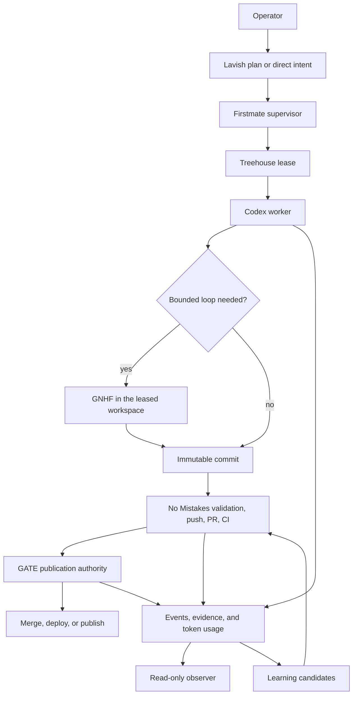

# GATE architecture

GATE is a personal, single-operator control plane for software delivery and evidence-led security work. It composes pinned upstream tools and adds only the coordination that those tools do not provide: a shared policy model, an append-only observer, a publication authority, an active-security authority, and durable learning. This document describes the target architecture; [README.md](../README.md#current-limits) identifies which v0.1 paths are wired today.

The repository is the reusable public distribution. Live sessions, target details, raw evidence, credential references, and private learning stay outside Git under `GATE_HOME`. Credential values should remain in an OS secret store or narrowly permissioned file outside broad agent-writable roots.

## Design constraints

- The laptop is the default execution environment.
- Codex CLI is the primary runtime harness. Firstmate does not currently support Codex App as a runtime backend.
- A person must be able to bootstrap, inspect, start, stop, and reset GATE without an AI.
- Upstream projects remain pinned dependencies. GATE does not combine their source trees.
- Each state transition has one owner.
- Active target contact follows a reviewed, digest-bound engagement plan.
- Every claim distinguishes observation, inference, and what remains unverified.
- Every persistent lesson records the cause and the resulting change.
- Missing token data is shown as unavailable; estimates are labeled.

## Control flow

Security work adds a separate authority path:

```mermaid
flowchart LR
    I[Local research and hypotheses] --> R[Plan and coverage map]
    R --> Q[No Mistakes plan review]
    Q --> U[Operator sees and approves exact digest]
    U --> B[GATE engagement broker]
    B --> X[In-scope tools]
    X --> E[Private evidence]
    E --> REA[REA analysis]
    REA --> D[Validated report and retest]
    D --> L[Learning candidates]
```

Changing a target, action class, exclusion, data destination, or limit invalidates the receipt. In the target design, a reviewed adapter can continue autonomously inside the approved envelope. v0.1 stops at target/action preflight because no generic active adapter meets that contract.

## Ownership

| Component | Owns | Does not own |
|---|---|---|
| Firstmate | Intake, supervisor state, dispatch, decision inbox | Worktree lifecycle, target authorization, publication |
| Treehouse | Development workspace leases, ownership, health, cleanup | Orchestration or security isolation |
| GNHF | A bounded iterative task inside one exclusive lease | Worktree creation, push, PR, or policy |
| No Mistakes | Handoff, rebase, review, tests, documentation, lint, push, PR, CI | Merge, deployment, target authorization, arbitrary tool execution |
| GATE publication authority | Read-only exact-head and required-check preflight in v0.1; trusted mutation adapters in the target design | Editing or reviewing the change |
| GATE engagement broker | Plan receipt and target/action preflight; future scope-aware adapter admission | Creating its own authorization or launching arbitrary commands |
| REA | Analysis of binaries, artifacts, saved captures, and runtime evidence | Traffic acquisition or active target operations |
| AXI | Agent-facing command and output conventions | Trust, policy, or orchestration |
| Skills CLI | Installation and synchronization of reviewed skills | Deciding whether a skill is trustworthy |
| Lavish | A local interactive plan or decision artifact | Continuous operations monitoring |
| Observer | Read-only GATE activity, derived agent/task, learning, status, and token views | Execution |
| Learning pipeline | Correction capture and validated memory changes | Expanding authorization or releasing data |

No Mistakes deliberately stops when a PR is ready. In v0.1, the publication authority can only inspect PR state, exact head, mergeability, and required checks. A future mutation adapter must verify a No Mistakes attestation bound to that head before it can merge, deploy, or publish. GATE never reports that upstream No Mistakes performed those actions.

## State and data boundaries

Tracked repository content:

- schemas, policies, templates, and configuration defaults;
- reviewed project-scoped skills and exact dependency locks;
- sanitized repository-wide lessons;
- documentation and adapters.

Private runtime content under `GATE_HOME`:

- `events.jsonl` and `tokens.jsonl`;
- engagement plans, authorization evidence, receipts, and audit trails;
- raw captures, binaries, screenshots, recordings, and tool output;
- private learning records;
- upstream checkouts, workspaces, process state, and logs.

The default is `$HOME/.local/share/gate`. `GATE_HOME` overrides it. Machine-specific settings may be placed at `$HOME/.config/gate/config.json`; v0.1 has a merge helper for that file but most commands do not yet load a complete merged provider/profile configuration. The target precedence is repository defaults, selected profile, local override, then explicit command-line arguments.

Tracked secrets may appear only as `env://`, `keychain://`, or `file://` references. v0.1 validates those shapes and redacts recognized sensitive text in supported event paths, but it has no general secret resolver or data-flow policy engine. Keep credential values in an OS secret store or narrowly permissioned file outside broad agent-writable roots.

`GATE_HOME` is one local trust domain for engagement authority and private evidence in v0.1. A process that can rewrite engagement state and its unsigned local receipt can forge consistency. Managed-upstream installation receipts are evidence only: full npm verification reconstructs a clean tree from the repository-tracked dependency lock and integrity cache, while release verification checks bytes against hashes in the reviewed upstream lock. A writer limited to `GATE_HOME` cannot re-anchor altered upstream bytes. Whole-root write access still belongs only to trusted operator processes.

## Execution environments

Host execution is the default because the operator has authorized laptop use and several security tools need a GUI, browser certificate store, raw host capture, USB or ADB, a GPU, or a physical network interface.

Pinned rootless OCI profiles are the target design for conflicting or heavy command-line tools; v0.1 does not ship those profiles. They will organize dependencies and will not be treated as a security boundary for hostile code. A broader Kali container can provide compatibility after a pinned image and SBOM exist, while purpose-specific packs remain the reproducible source of truth. A VM is optional and should be introduced only after its setup, start, smoke-test, reset, and stop flow is repeatable without an AI.

Treehouse worktrees isolate Git changes. They do not isolate processes, credentials, networks, caches, the kernel, or the host filesystem.

## Code lifecycle

1. Firstmate records intent, acceptance criteria, risk, delivery mode, and merge posture.
2. Treehouse grants a fresh exclusive lease.
3. Codex works inside the lease using reviewed skills and admitted tools.
4. GNHF may run only as a bounded leaf task in that lease. Iteration, time, token, and failure caps are mandatory.
5. The worker hands an immutable commit to No Mistakes.
6. No Mistakes owns review through green CI. No other reviewer or publisher mutates the same branch during this stage.
7. The v0.1 publication authority performs a read-only exact-head and required-check preflight. A future trusted adapter verifies the external No Mistakes attestation and project policy before any merge, deployment, or publication.
8. The observer records the final state and Treehouse releases the lease only after work is landed or explicitly abandoned.

## Security lifecycle

Passive public research, local static analysis, hypothesis generation, and saved-evidence analysis can proceed without an engagement receipt. Network probes, interception, authentication, fuzzing, exploitation, persistence, destructive tests, denial-of-service tests, or data removal require a valid receipt.

An engagement contains:

- authorization basis, evidence, and validity window;
- precise included and excluded selectors;
- permitted action classes and execution environment;
- hypotheses, depth, commands, coverage, and completion tests;
- request, rate, concurrency, duration, and token limits;
- data destinations, retention, and secret references;
- stop conditions;
- No Mistakes review evidence and an operator receipt for the exact plan digest.

The broker can check the receipt for an exact target and action. Its result is explicitly marked `preflightOnly: true` and `executionAvailable: false`, with both operator and No Mistakes attestation status set to `local-unverified`. Arbitrary active execution is disabled in v0.1: raw `gate run`, `gate upstream exec`, and `gate engagement exec` launchers fail closed. A future reviewed tool-specific adapter must bind exact arguments to scope, record versions and evidence hashes, enforce approved limits and stop conditions, terminate the process group, and reject unknown flags. Scope expansion requires a new plan and receipt.

The completion contract covers asset discovery, architecture, authentication, authorization, sessions, inputs, business logic, client behavior, data exposure, infrastructure, supply chain, and post-exploitation impact. Each surface should be covered or carry an explicit limitation, and empty scanner output is not sufficient. v0.1 validates these fields as data; `engagement close` is administrative and does not evaluate or certify completion.

## Evidence model

Every finding carries:

- a stable claim ID and concise statement;
- `observed`, `inferred`, or `unverified`;
- raw evidence references and hashes;
- tool, version, command, target, and timestamp;
- an independent validation or an explicit reason it was not possible;
- limitations and residual unknowns;
- impact, reproduction, remediation, and retest state.

Target output, webpages, binaries, captures, and tool responses are untrusted data. They may create a learning candidate but cannot directly change memory, policy, or authorization.

## Observation and token accounting

GATE commands append normalized events and the observer only reads state. Today it shows GATE activity, derived agent/task state, effect classes, learning, freshness, upstream and engagement summaries through the status API, and token data when available. Firstmate, Treehouse, No Mistakes, ordinary Codex turns, and tool adapters still need direct event bridges before this is a complete fleet view.

Token records state whether values are `exact`, `estimated`, or `unavailable`, and identify the source and whether a value is a delta or cumulative counter. The v0.1 scanner streams local Codex session JSONL and parses only lines carrying recognized usage markers; prompt-bearing bytes can therefore pass through the scanner, but prompt bodies are never returned by the observer. A direct harness adapter is the target design. Missing values are never rendered as zero.

## Learning and evolution

Corrections, failures, retries, workarounds, tool gaps, better-tool discoveries, policy violations, benchmark regressions, evidence contradictions, and environment constraints create learning candidates.

Agents record session observations privately through the explicit learning command. Project and repository behavior changes must pass through No Mistakes before promotion, but v0.1 does not invoke that workflow automatically. Each machine record in `memory/learnings.jsonl` is one physical line with a cause, a concrete change, evidence, status, sensitivity, and affected configuration. [LEARNINGS.md](../memory/LEARNINGS.md) is the reviewed human-readable ledger. Public lessons omit secrets and target identifiers.

Learning cannot expand target scope, authorization, data destinations, secret release, publication permission, or destructive-action permission.

When an operator or agent finds a better tool, the operating contract requires comparison of task success, reproducibility, maintenance, license, platform compatibility, effects, token cost, and ergonomics. The agent evaluates it in an isolated install root, runs a smoke test, pins the selected version and integrity data, records the lesson, and passes the persistent change through No Mistakes. v0.1 does not discover or admit catalog tools automatically.

## Authoritative contracts

- [gate.config.json](../config/gate.config.json) declares the target providers and runtime defaults.
- [autonomy.json](../policies/autonomy.json) defines action authority.
- [data-handling.json](../policies/data-handling.json) owns classification and release.
- [engagements.json](../policies/engagements.json) owns active-security receipts and completion.
- [learning.json](../policies/learning.json) owns durable adaptation.
- [updates.json](../policies/updates.json) owns dependency and tool admission.
- Files under [schemas](../schemas/) define the accepted machine-readable shape.

These files are normative contracts and are schema-validated. v0.1 has no general policy engine: the engagement broker, publication preflight, observer, learning path, and upstream manager enforce only the fields they explicitly load. Provider selection, workspace leases, full data-flow rules, and many lifecycle transitions remain procedural or planned. A missing, unreadable, unknown, expired, or digest-mismatched value must never be treated as authorization, and unavailable mutation adapters remain blocked.
