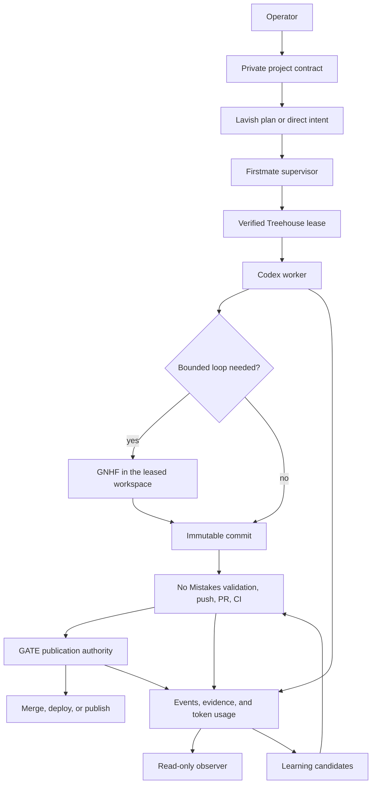

# GATE architecture

GATE is a personal, single-operator control plane for software delivery and evidence-led security work. It composes pinned upstream tools and adds only the coordination that those tools do not provide: a shared policy model, a private project registry, a reviewed managed-tool runtime, a project-bound offline-analysis lane, a verified Treehouse lease bridge, an append-only observer, a publication authority, an active-security authority, and durable learning. This document describes the target architecture; [README.md](../README.md#current-limits) identifies which v0.1 paths are wired today.

The version-controlled repository contains the reusable distribution. Live sessions, target details, raw evidence, credential references, and private learning stay outside Git under `GATE_HOME`. Credential values should remain in an OS secret store or narrowly permissioned file outside broad agent-writable roots.

## Design constraints

- The laptop is the default execution environment.
- Codex CLI is the primary runtime harness. Firstmate does not currently support Codex App as a runtime backend.
- A person must be able to bootstrap, inspect, start, stop, and reset GATE without an AI.
- Upstream projects remain pinned dependencies. GATE does not combine their source trees.
- Each state transition has one owner.
- Local-artifact authority never implies authority to contact the artifact's publisher or an endpoint extracted from it.
- Active target contact follows a reviewed, digest-bound engagement plan.
- Every claim distinguishes observation, inference, and what remains unverified.
- Every persistent lesson records the cause and the resulting change.
- Missing token data is shown as unavailable; estimates are labeled.

## Control flow

Security work begins with separate offline and active-authority paths:

```mermaid
flowchart LR
    P[Registered project] --> S[Private artifact snapshot]
    S --> Z[Fixed zero-network REA adapter]
    Z --> I[Offline observations and hypotheses]
    I --> R[Plan and coverage map]
    R --> Q[No Mistakes plan review]
    Q --> U[Operator sees and approves exact digest]
    U --> B[GATE engagement broker]
    B --> M{Execution lane}
    K[Reviewed managed runtime] --> M
    M -->|reviewed adapter| X[In-scope tools]
    M -->|one-shot confirmed manifest| X
    X --> E[Private evidence]
    E --> REA[REA analysis]
    REA --> D[Validated report and retest]
    D --> L[Learning candidates]
```

The offline branch is bound to a project contract and local snapshot rather than an engagement receipt. It cannot promote an observation into target contact. Changing a target, action class, permitted tool, execution environment, exclusion, data destination, or limit invalidates an active receipt. A reviewed adapter may continue inside the approved envelope according to its contract. The v0.1 generic lane accepts only `scope.environment: host` with receipt-approved `gate-home` because raw evidence always lands there. It creates an expiring one-shot manifest for one target, declared action label, permitted tool, catalog risk class, allowed destination set, exact argument array, executable descriptor, and set of bounds, then requires a second exact operator confirmation that acknowledges its unavailable controls. The complete sequence and handoff rules are mapped in the [end-to-end penetration-testing workflow](pentest-workflow.md).

## Ownership

| Component | Owns | Does not own |
|---|---|---|
| GATE project registry | Private validated project contracts and canonical repository identity | Repository checkout, task dispatch, authorization, or policy-wide enforcement |
| Firstmate | Intake, supervisor state, dispatch, decision inbox | Worktree lifecycle, target authorization, publication |
| Treehouse | Development workspace allocation, durable leases, and its versioned state format | Orchestration, safe destructive cleanup, or security isolation |
| GNHF | A bounded iterative task inside one exclusive lease | Worktree creation, push, PR, or policy |
| No Mistakes | Handoff, rebase, review, tests, documentation, lint, push, PR, CI | Merge, deployment, target authorization, arbitrary tool execution |
| GATE publication authority | Read-only exact-head and required-check preflight in v0.1; trusted mutation adapters in the target design | Editing or reviewing the change |
| GATE engagement broker | Plan receipt, target/action-label/tool/environment preflight, one-shot generic manifests, supervised execution, stop/revocation, and reviewed adapter admission | Creating its own authorization, interpreting arbitrary argv as an action proof, or launching an unbound command |
| GATE managed tool runtime | Exact GitHub-release lock validation, private artifact cache, staged install, zero-egress smoke, current-byte verification, removal, and lifecycle results | Target authority, argument semantics, data-pack admission, privilege brokering, or execution outside a separately approved lane |
| GATE offline-analysis lane | Project/artifact/runtime binding, private snapshots, one-shot confirmation, zero-network launch, and bounded evidence for the fixed REA adapter | Target contact, arbitrary REA commands, artifact execution, or authorization inferred from artifact contents |
| REA | Analysis of binaries, artifacts, saved captures, and runtime evidence | Traffic acquisition or active target operations |
| AXI | Agent-facing command and output conventions | Trust, policy, or orchestration |
| Skills CLI | Installation and synchronization of reviewed skills | Deciding whether a skill is trustworthy |
| Lavish | A local interactive plan or decision artifact | Continuous operations monitoring |
| Observer | Read-only GATE activity, derived agent/task, learning, status, and token views | Execution |
| Learning pipeline | Correction capture and validated memory changes | Expanding authorization or releasing data |

No Mistakes deliberately stops when a PR is ready. In v0.1, the publication authority can only inspect PR state, exact head, mergeability, and required checks. A future mutation adapter must verify a No Mistakes attestation bound to that head before it can merge, deploy, or publish. GATE never reports that upstream No Mistakes performed those actions.

## State and data boundaries

Tracked repository content:

- schemas, policies, templates, and configuration defaults;
- reviewed project-scoped skills and exact upstream and managed-tool dependency locks;
- sanitized repository-wide lessons;
- documentation and adapters.

Private runtime content under `GATE_HOME`:

- `events.jsonl` and `tokens.jsonl`;
- engagement plans, authorization evidence, receipts, active and offline one-shot manifests and claims, offline input snapshots, run metadata, sandboxes, and audit trails;
- registered project contracts, including repository and delivery references;
- raw captures, binaries, screenshots, recordings, and tool output;
- private learning records;
- upstream checkouts, content-addressed managed-tool archives, staging trees, installed tool executables and receipts, private clone-bound and task-bound Treehouse roots, process state, and logs.

The default is `$HOME/.local/share/gate`. `GATE_HOME` overrides it. Machine-specific settings may be placed at `$HOME/.config/gate/config.json`; v0.1 has a merge helper for that file but most commands do not yet load a complete merged provider/profile configuration. The target precedence is repository defaults, selected profile, local override, then explicit command-line arguments.

Tracked secrets may appear only as `env://`, `keychain://`, or `file://` references. v0.1 validates those shapes and redacts recognized sensitive text in supported event paths, but it has no general secret resolver or data-flow policy engine. Keep credential values in an OS secret store or narrowly permissioned file outside broad agent-writable roots.

`GATE_HOME` is one local trust domain for project configuration, offline-analysis provenance, engagement authority, active-execution provenance, private evidence, and managed installations in v0.1. A process that can rewrite project, offline-analysis, or engagement state can change the local configuration or history it describes, including snapshots, manifests, claims, unsigned receipts, runs, stops, and evidence. Exclusive files and hashes coordinate trusted processes rather than protecting state from that same-user writer. Managed installation receipts are evidence only. Full npm verification reconstructs a clean tree from the repository-tracked dependency lock and integrity cache, release-upstream verification checks bytes against the reviewed upstream lock, and managed-tool verification checks the catalog-entry digest, runtime-lock entry, exact installed tree, current executable bytes, and zero-egress smoke. Reconstruction invokes the npm CLI contained by the real installation of the running Node executable through that exact Node path and a minimal environment with empty explicit user/global npm configs; it does not resolve npm from `PATH` or inherit `NODE_OPTIONS`. Source verification likewise resolves a fixed locked-down system Git and supplies only a controlled command path and Git environment. A writer limited to `GATE_HOME` cannot re-anchor altered upstream or managed-tool bytes without also changing the reviewed repository lock or catalog. Whole-root write access still belongs only to trusted operator processes.

### Project registry boundary

`gate project register` imports a bounded regular non-symlink JSON source, validates it with [project.schema.json](../schemas/project.schema.json), canonicalizes its repository identity, checks the default branch and referenced profiles, and writes an owner-only canonical record under `GATE_HOME/projects`. Both imported and canonical stored UTF-8 representations must fit the registry byte ceiling. Local `file://` locators are normalized to their physical realpath and must continue to resolve there during later loads. A serialized writer lock prevents concurrent replacement. The registry accepts an identical registration idempotently and rejects changed content for an existing ID or a second ID for the same case-normalized forge repository. Registration writes `.registry.pending` before publishing the contract and removes it only after the transaction-bound private audit event is flushed. A contract-write failure rolls back the exact record when safe. An audit append, flush, or close error preserves both contract and marker because the event outcome is ambiguous; an abrupt interruption leaves the same fail-closed state. The marker binds the project ID, event ID, random transaction nonce, and SHA-256 of the canonical contract to the event evidence reference. While either the lock or pending marker exists, full reads fail or return invalid/degraded status rather than treating the transaction as complete.

`project show` is the explicit full-contract read. `project list`, general status, and the observer use summaries that omit repository URLs and deployment destinations; the observer replaces the project ID with a process-local keyed pseudonym. Invalid and unexpected entries remain visible as invalid. v0.1 has no update or delete transition, and the registry is not a source of security authorization.

The registry does not yet dispatch Firstmate, clone a repository, select a project implicitly, bind a Treehouse repository path to a registered identity, or make publication and deployment adapters enforce every delivery field. Those transitions require narrow owner bridges rather than treating schema validity as runtime enforcement.

## Execution environments

Host execution is the default because the operator has authorized laptop use and several security tools need a GUI, browser certificate store, raw host capture, USB or ADB, a GPU, or a physical network interface.

The offline-analysis lane is a distinct Linux/WSL2 execution environment for one fixed operation. Manifest creation copies an exact absolute regular file into private state, hashes it, and binds its bytes and source identity to the current canonical project-contract digest. It also binds the reviewed `rea-stable` version, full source commit, npm integrity and lock digest; the observed SHA-256 and file identity of Bubblewrap, Node, the GATE adapter, and the REA entrypoint; fixed environment, mounts, and arguments; private evidence paths; a wall-duration bound; and zero requests, request rate, and model tokens. The manifest expires after at most 15 minutes and a durable claim consumes it before spawn.

The cheap capability path confirms prerequisite file presence and launches `/usr/bin/true` through the actual minimal Bubblewrap namespace shape. It does not reconstruct or hash the full managed REA npm tree. Manifest creation performs the reviewed-lock reconstruction, observes the Bubblewrap, Node, adapter, and REA entrypoint hashes and filesystem identities, and stores those bindings. Execution repeats the full upstream reconstruction and runtime identity checks before invoking Bubblewrap through its already-open descriptor. Bubblewrap creates fresh user, PID, network, IPC, and UTS namespaces, requests a cgroup namespace where supported, disables nested user namespaces, drops all capabilities, clears the environment, mounts `/usr` and every runtime/input descriptor read-only, and gives the process private temporary directories. The fixed adapter invokes only REA `inspect-pe-resources`; it never executes the supplied PE. Successful output must attest that the namespace exposes only loopback, has no IPv4 routes, has zero inherited, permitted, effective, bounding, and ambient capabilities, and has `NoNewPrivs`. This does not provide CPU or memory quotas, an immutable same-UID snapshot of the managed REA tree, protection from another same-UID writer to `GATE_HOME`, or syscall-level denial of Unix sockets. The capability probe proves only that the minimal namespace launched at that time; a completed adapter run supplies the bound in-namespace observations.

The managed tool runtime turns seven catalog entries into exact private installations without changing target authority. [`tool-runtimes.lock.json`](../locks/tool-runtimes.lock.json) binds the exact catalog-entry digest, version, full source commit, release evidence, artifact identity, URL, size, archive and executable SHA-256, exact archive members, executable path, platform, and bounded smoke. The 28 artifacts cover Linux and macOS on x64 and ARM64. All observed releases were marked non-immutable by GitHub; six ProjectDiscovery source commits carried provider verification, while the FFUF source commit did not. GATE therefore treats the reviewed hashes and exact release identities as the byte anchors rather than claiming signed or immutable provider releases.

`prefetch` stores the size- and digest-verified archive under the private content-addressed cache. `install` rechecks those bytes, rejects unsafe, linked, duplicate, case-colliding, missing, or extra archive members, extracts only the locked executable, and creates an exact private staging tree. On Linux/WSL2 it invokes protected system Bubblewrap directly with no shell, creates a fresh zero-network namespace, and applies `prlimit` inside the new user/PID namespace before running only the locked version smoke. The smoke bounds wall time, output, process count, and network access, but does not independently cap memory, open file descriptors, or file size beyond private temporary filesystems and host limits. A passing staged tree is atomically promoted as one executable plus its receipt, with atomic rollback on publication failure. `verify` checks the repository lock and catalog binding, exact installed tree, current executable bytes, receipt evidence, and a new smoke whose output digest must match installation. `remove` atomically retires the runtime from its active path and retains the content-addressed archive, whose next reuse verifies exact bytes; restoration after a deletion failure is best effort. Mutation serialization and crash recovery follow the [managed-runtime recovery contract](security-tooling.md#managed-core-runtime). macOS artifacts are prefetch-only until an equivalent zero-egress smoke supervisor exists; native Windows has no locked artifact.

Lifecycle results state that installation grants no authority. All seven verified runtimes remain invocation-blocked until reviewed workflow-phase adapters bind their action and argument semantics. `naabu` additionally needs a reviewed raw-network privilege adapter, and `nuclei` additionally needs admission of exact templates. `tool list --profile core` performs no network access or process execution and treats a receipt as receipt-only evidence; broader inventory can run an existing adapter's capability probe. The observer and normal status path validate dated receipt evidence without rereading executable bytes or claiming current verification. Normal doctor hashes current bytes; explicit plan, verify, and full doctor paths also rerun live smoke.

The supervised generic lane runs only on Linux or WSL2 and accepts only engagements approved for `scope.environment: host` and the `gate-home` evidence destination. It is a process-control and evidence boundary rather than a sandbox; container, rootless-container, VM, and remote-lab receipts require another lane that creates the named environment. It resolves a permitted catalog command only when its `commandIdentity.genericLaneAdmission` allows `path-discovery`. A `reviewed-admission` PATH entry may expose a candidate for diagnostics, but its readiness is `identity-unverified`; GATE withholds that candidate as the executable and blocks generic and broad capability. A verified managed runtime takes precedence over every PATH namesake but is also withheld from the generic lane pending workflow-phase admission; GATE does not fall back to the ambient command. This prevents an ambiguous `httpx` command from identifying the wrong product and prevents the fixed REA adapter from admitting REA's broader A2 surface.

For an eligible PATH command, GATE opens and hashes its regular executable, rechecks descriptor metadata immediately before spawn, and launches the still-open descriptor through `/proc/self/fd` with `shell: false`, an empty stdin, a minimal fixed environment, a private working directory, and bounded private output files. Known-good executable provenance remains unavailable for this PATH-only lane. While the original supervisor remains alive, a fresh process group supports best-effort wall-duration, revocation, stop, `SIGTERM`, and `SIGKILL` handling. A supervisor crash or `SIGKILL` has no takeover path and can leave that ordinary tool process group alive. The child retains the same UID and host authority. A same-UID writer can mutate a writable executable inode before or during exec, so the observed descriptor digest is not an immutable launched snapshot. Same-user access, interpreters, dynamic libraries, plug-ins, configuration, input files, children, and escaped daemons remain outside that digest.

Pinned rootless OCI profiles are the target design for conflicting or heavy command-line tools; v0.1 does not ship those profiles. They will organize dependencies and will not be treated as a security boundary for hostile code. A broader Kali container can provide compatibility after a pinned image and SBOM exist, while purpose-specific packs remain the reproducible source of truth. A VM is optional and should be introduced only after its setup, start, smoke-test, reset, and stop flow is repeatable without an AI.

Treehouse worktrees provide change isolation. They do not isolate processes, credentials, networks, caches, the kernel, or the host filesystem. Worktrees from one clone also share the common `.git`: unknown or hostile same-user code can mutate hooks, configuration, objects, and refs outside its worktree. Such code requires a standalone clone or an OS sandbox.

The v0.1 workspace bridge runs only on Linux or WSL2 and implements three GATE operations: lease, aggregate status, and nonmutating verification. Before every operation it requires the managed Treehouse 3.1.3 executable to be `integrityState: verified` and selects a fixed trusted system Git. Lease acquisition is the only Treehouse subprocess: `treehouse get --lease --json --no-fetch --branch BRANCH --lease-holder HOLDER [--base BASE]`, with update checks and interaction disabled. Omitting `--base` leaves base selection to repository Treehouse configuration. GATE never invokes Treehouse `status`, `return`, `destroy`, `prune`, or `enter`. Treehouse and Git receive a constructed minimal environment with an empty private home and private temporary directory. Inherited credentials, proxies, SSH agents, language loaders, and general session variables are absent.

Private Treehouse state is partitioned first by a binding to the physical main clone and then by a SHA-256 task-ID root. A lease creates its task root exclusively; an existing root burns that task ID and is never reused. Fresh task IDs therefore allocate fresh roots. Each physical clone has a lifetime ceiling of 511 retained task roots. Capacity recovery requires a new physical clone or future mount-safe upstream lifecycle support, never deletion or reuse of a retained root.

GATE status and verification never query Treehouse. They stable-read the clone and task bindings, exact version-4 state with one healthy lease, and exact 32-byte owner-only state key. The bridge verifies the seed-inventory HMAC and binds SHA-256 of the raw state and key bytes into the immutable completed receipt. The HMAC covers only the seed inventory; lease evidence also depends on the trusted `get` receipt and immutable raw-file digests. Treehouse 3.1.3 status recovery can move user files, so treating it as a read-only query is unsafe.

Lease always uses Treehouse `--no-fetch`; GATE also disables Git lazy fetch and every transport. Any requested branch, base, object, or blob must already be local. Acquiring or refreshing refs is a separate reviewed network workflow because the bridge supplies no credential, proxy, SSH, or network broker. Before and after Treehouse execution, GATE accepts only a narrow reviewed allowlist of shared repository-local and per-worktree configuration keys with validated values; every unreviewed key fails closed. This excludes includes, filters, diff/merge drivers, credential and SSH commands, editors, pagers, external protocols, worktree redirection, commit graphs, and weakened stat behavior. Git LFS filters are blocked until a reviewed integration exists. Separate inspections cannot exclude a concurrent same-user writer to the shared Git directory.

Before acquisition, GATE durably writes a `pending` lease binding. After `get`, it checks the returned base, path, lease ID, holder, timestamp, and branch against the direct state read and requires the path to remain within the bound private task root. Before reporting success it rejects Git operation and transaction locks, submodules, nested Git metadata, hidden or staged real-index state, corrupt or altered object graphs, and unreachable objects. It builds a controlled checkout of exact `HEAD` with a private fresh index and compares file types, modes, links, symlinks, paths, and bytes against the real workspace under bounded entry, byte, and time limits. Extra and ignored workspace paths fail. GATE then persists the durable `workspace.leased` event and atomically replaces `pending` with a `complete` binding containing the event receipt and immutable state/key digests, followed by another state read. Treehouse persists the lease beyond the GATE process; interruption leaves a retained pending or unbound lease that aggregate status reports as unverified.

`workspace verify` repeats the lease and repository identity checks without mutating Treehouse. The supplied repository must be the main worktree, both worktrees must share one common Git directory, and the landed-ref name must equal the branch checked out in the main worktree. Verification rejects active processes, in-progress operations, submodules, nested metadata, grafts, alternates, replacement refs, altered or unreachable objects, hidden or staged index state, and any leased-workspace bytes outside the exact current `HEAD`. Ignored cache paths are allowed only in the main worktree. After rechecking object integrity, it proves that the exact workspace `HEAD` is an ancestor of `refs/heads/BRANCH`. This establishes local reachability only; it is not provider, No Mistakes, or publication proof. The command records `workspace.verified` and retains the durable lease.

Automatic return, reset, destruction, and slot reuse are disabled. Reproduced Treehouse 3.1.3 bind-mount races can cause destructive cleanup to alter or delete host data, and the upstream release exposes no primitive that can make that transition safe. Operators and agents must never invoke any Treehouse command directly against a GATE root, including status. Each retained lease and one-shot task root consumes disk. Cleanup remains a future mount-safe upstream integration; GATE does not claim a power-loss durability guarantee.

Workspace operations are serialized by an owner-only clone-specific lock. When aggregate status reports `operation-lock-present`, it has inspected no task or Git state. Manual clearance must prove no GATE operation or related Treehouse/Git child remains, reject malformed or unsafe lock metadata, treat a live `/proc/PID` as non-removable even after PID reuse or reboot, revalidate the exact lock's device, inode, metadata, and content immediately before unlinking only that file, and rerun GATE status before mutation. The ordered procedure is in [the operating model](operating-model.md#operation-lock-recovery).

## Code lifecycle

1. The operator registers and verifies the private project contract; Firstmate records intent, acceptance criteria, risk, delivery mode, and merge posture outside GATE's current bridge.
2. GATE invokes the verified Treehouse bridge, which grants a fresh exclusive durable lease and returns its checked identity.
3. Codex works inside the lease using reviewed skills and admitted tools.
4. GNHF may run only as a bounded leaf task in that lease. Iteration, time, token, and failure caps are mandatory.
5. The worker hands an immutable commit to No Mistakes.
6. No Mistakes owns review through green CI. No other reviewer or publisher mutates the same branch during this stage.
7. The v0.1 publication authority performs a read-only exact-head and required-check preflight. A future trusted adapter verifies the external No Mistakes attestation and project policy before any merge, deployment, or publication.
8. The observer records available GATE state. GATE verifies that the exact clean, inactive workspace head is locally reachable from the named checked-out branch, then retains the lease for manual reconciliation.

Only the project registry and Treehouse lease/status/verify portions of this lifecycle are newly wired. GATE still does not invoke Firstmate, launch Codex or GNHF, hand a branch to No Mistakes, verify No Mistakes attestations, land a change, safely destroy a Treehouse root, or perform publication mutation.

## Security lifecycle

Passive public research, local static analysis, hypothesis generation, and saved-evidence analysis can proceed without an engagement receipt under their data and provider rules. Network probes, interception, authentication, fuzzing, exploitation, persistence, destructive tests, denial-of-service tests, or data removal require a valid receipt.

The implemented local-static path accepts a lawfully supplied artifact only. A proprietary client or other proprietary binary remains private under `GATE_HOME`; possession and offline-analysis authority do not authorize downloading it, contacting the vendor, resolving or connecting to embedded endpoints, using accounts, testing updates, or interacting with third-party services. Manifest creation binds the input to a registered project for provenance, but the registry is not target authority. Endpoint strings become unverified hypotheses. Moving any hypothesis into passive-provider retrieval or live target contact follows the explicit `local-to-network-hypothesis` handoff in the [end-to-end workflow](pentest-workflow.md), including independent ownership resolution and a separately reviewed active engagement when contact is proposed.

Offline snapshot retention has fixed ceilings of 64 artifacts and 2 GiB. Snapshot admission, execution claim, and explicit digest-bound purge share one private lock. A durable creation intent lets the next lock holder distinguish and remove an incomplete snapshot from one protected by a durably published manifest. Purge deletes only the bound snapshot after an abandoned, expired, or terminal transition and preserves lifecycle records and evidence. Aggregate evidence retention is a separate unresolved storage bound.

An engagement contains:

- authorization basis, evidence, and validity window;
- precise included and excluded selectors;
- permitted action classes, permitted catalog tool IDs, and execution environment;
- hypotheses, depth, commands, coverage, and completion tests;
- request, rate, concurrency, duration, and token limits;
- data destinations, retention, and secret references;
- stop conditions;
- No Mistakes review evidence and an operator receipt for the exact plan digest.

The broker checks the receipt for an exact target and declared action label and returns a digest binding to that decision, including the execution environment and permitted tool IDs. The label is authorization metadata, not validation that arbitrary argv has the same semantics. Operator and No Mistakes provenance remains `local-unverified`: their identifiers are locally recorded rather than externally attested. Scope expansion requires a new plan and receipt.

Active execution has two lanes. A reviewed tool-specific adapter can validate its own flags and enforce tool-aware limits. The supervised generic lane admits a catalog-discovered, PATH-eligible executable on Linux or WSL2 for one host launch only and requires receipt-approved `gate-home` because raw evidence always lands there. Verified managed core runtimes are not eligible until reviewed workflow-phase adapters exist. Generic manifest creation requires exactly one whole-argument `{{GATE_TARGET}}` placeholder and binds the expanded argument array, target argument index, target selector, declared action label, permitted tool and catalog risk class, engagement plan/envelope/receipt hashes, host environment, allowed destinations, authorization expiry, executable descriptor metadata and observed SHA-256, declared bounds, private evidence paths, and expiry. Execution requires the literal `EXECUTE MANIFEST_ID MANIFEST_SHA256 UNMETERED` confirmation. An exclusive claim is durable before spawn, so the manifest cannot be replayed even when launch or supervision fails.

The generic lane enforces engagement and host-environment binding, receipt-bound allowed destinations including `gate-home`, target-argument binding, `declared-action-label-binding`, tool allowlist and catalog-risk binding, exact arguments, no-shell descriptor execution, a minimal environment, private bounded stdout and stderr, declared bounds within the receipt, `executable-descriptor-observed-sha256`, and the one-shot claim. Authorization/revocation/stop polling, wall duration, and process-group termination are best effort and require the original supervisor to remain alive. `argv-action-semantics-validation`, egress-target restriction, request count and rate measurement, tool concurrency and token measurement, daemon-escape containment, `supervisor-crash-containment`, `immutable-executable-snapshot`, filesystem isolation, credential brokering, full artifact inventory, and known-good executable provenance are unavailable and recorded as such. Durable stop and revocation files do not provide takeover supervision; a supervisor crash or force-kill can leave the original process group running, and processes can also leave that group. If authenticated group identity is lost during teardown, GATE records status `unknown` with termination reason `supervision-lost` instead of claiming termination. Arbitrary argv can exceed the declared label, so the operator reviews it and reviewed adapters remain the only lane that validates tool-specific flags. Execution events use the maximum of the declared action effect and catalog risk ceiling as a conservative audit classification; that label does not block launch. The observed SHA-256 is the bytes read through the opened descriptor. A same-UID writer can mutate a writable inode before or during exec, so the digest does not prove atomically frozen launched bytes or the runtime dependency graph. Raw `gate run`, `gate upstream exec`, and argument-taking execution shortcuts remain disabled.

The completion contract covers asset discovery, architecture, authentication, authorization, sessions, inputs, business logic, client behavior, data exposure, infrastructure, supply chain, and post-exploitation impact. Each surface should be covered or carry an explicit limitation, and empty scanner output is not sufficient. v0.1 validates these fields as data; `engagement close` is administrative and does not evaluate or certify completion.

## Evidence model

Every finding carries:

- a stable claim ID and concise statement;
- `observed`, `inferred`, or `unverified`;
- raw evidence references and hashes;
- tool, version, command, target, and timestamp;
- an independent validation or an explicit reason it was not possible;
- limitations and residual unknowns;
- impact, reproduction, remediation, and retest state.

Target output, webpages, binaries, captures, and tool responses are untrusted data. They may create a learning candidate but cannot directly change memory, policy, or authorization.

## Observation and token accounting

GATE commands append normalized events and the observer only reads state. Today it shows GATE activity, derived agent/task state, effect classes, learning, freshness, managed runtime counts and privacy-filtered constraints, upstream, engagement, supervised execution, offline-analysis, and privacy-filtered project summaries through the status API, and token data when available. The managed runtime projection exposes tool IDs, states, reason categories, and the bounded kind, timestamp, age, and current-check flags from verification evidence while omitting private paths, hashes, raw receipts, and raw verifier errors; its unresolved count spans all 126 catalog entries rather than only failed installs. Offline analysis emits manifest-created, queued, started, and completed events; generic execution emits queued, started, completed, and stop-requested events; Treehouse workspace state is available on demand through `gate workspace status`. Firstmate, Treehouse, GNHF, No Mistakes, ordinary Codex turns, and broader reviewed tool adapters still need complete event bridges before this is a complete fleet view.

Token records state whether values are `exact`, `estimated`, or `unavailable`, and identify the source and whether a value is a delta or cumulative counter. The v0.1 scanner streams local Codex session JSONL and parses only lines carrying recognized usage markers; prompt-bearing bytes can therefore pass through the scanner, but prompt bodies are never returned by the observer. A direct harness adapter is the target design. Missing values are never rendered as zero.

## Learning and evolution

Corrections, failures, retries, workarounds, tool gaps, better-tool discoveries, policy violations, benchmark regressions, evidence contradictions, and environment constraints create learning candidates.

Agents record session observations privately through the explicit learning command. Project and repository behavior changes must pass through No Mistakes before promotion, but v0.1 does not invoke that workflow automatically. Each machine record in `memory/learnings.jsonl` is one physical line with a cause, a concrete change, evidence, status, sensitivity, and affected configuration. [LEARNINGS.md](../memory/LEARNINGS.md) is the reviewed human-readable ledger. Public lessons omit secrets and target identifiers.

Learning cannot expand target scope, authorization, data destinations, secret release, publication permission, or destructive-action permission.

When an operator or agent finds a better tool, the operating contract requires comparison of task success, reproducibility, maintenance, license, platform compatibility, effects, token cost, and ergonomics. The agent evaluates it in an isolated install root, runs a smoke test, pins the selected version and integrity data, records the lesson, and passes the persistent change through No Mistakes. v0.1 can materialize the seven reviewed core releases and discover compatible catalog executables already present on `PATH`; the other 119 entries still need exact provider locks and their declared admission work.

## Authoritative contracts

- [gate.config.json](../config/gate.config.json) declares the target providers and runtime defaults.
- [autonomy.json](../policies/autonomy.json) defines action authority.
- [data-handling.json](../policies/data-handling.json) owns classification and release.
- [engagements.json](../policies/engagements.json) owns active-security receipts and completion.
- [pentest-e2e.json](../config/workflows/pentest-e2e.json) maps the 28 security phases, prerequisites, evidence, stops, and handoffs; it grants no authority.
- [learning.json](../policies/learning.json) owns durable adaptation.
- [updates.json](../policies/updates.json) owns dependency and tool admission.
- [tool-runtimes.lock.json](../locks/tool-runtimes.lock.json) binds the seven managed core releases, artifacts, executable hashes, platforms, and zero-egress smoke specifications.
- Files under [schemas](../schemas/) define the accepted machine-readable shape.

These files are normative contracts and are schema-validated. v0.1 has no general policy engine: the project registry, Treehouse workspace bridge, engagement broker, publication preflight, observer, learning path, and upstream manager enforce only the fields they explicitly load. Cross-component provider selection, project-policy propagation, full data-flow rules, and many lifecycle transitions remain procedural or planned. A missing, unreadable, unknown, expired, or digest-mismatched value must never be treated as authorization, and unavailable mutation adapters remain blocked.
