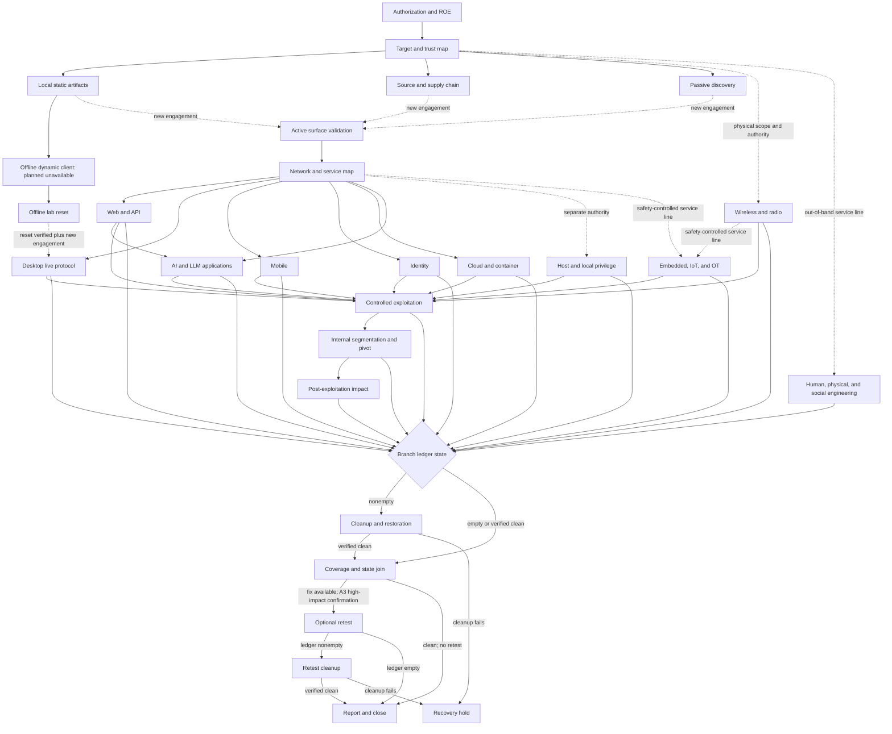

# End-to-end penetration testing workflow

GATE uses [`config/workflows/pentest-e2e.json`](../config/workflows/pentest-e2e.json) as the machine-readable map for a complete penetration test. [`schemas/pentest-workflow.schema.json`](../schemas/pentest-workflow.schema.json) validates its structure. The shared semantic validator used by `gate validate` and the workflow tests checks references, tool catalog joins, transition reachability, dependency dominance, destination authorization gates, cleanup and recovery paths, radio action boundaries, retest authorization, and the two terminal states.

The workflow is a playbook. It does not grant authority or prove that a tool, adapter, or lab is available. A command can run only when the exact operation satisfies its applicable authorization and data contracts, the selected execution path is available, and every control on which the plan depends is enforced. Target contact requires the current engagement; the [fixed offline-analysis lane](operating-model.md#offline-static-artifact-analysis) has its own project-bound manifest and confirmation. Catalog entries describe candidate capabilities and their maximum normal effect.

## Operating graph

The diagram condenses a typed directed acyclic graph. Each JSON transition records:

- `kind`: normal progress, a stop, or a failure;
- `condition`: the evidence-based condition under which the edge applies;
- `guard.applicability`: whether the phase is applicable or all required dispositions have joined;
- `guard.ledger`: `any`, `empty`, `nonempty`, or `verified-clean`;
- `guard.authorization`: no active authority, the current engagement, a new engagement, or preauthorized teardown;
- `handoffId` when crossing a separately reviewed approval boundary.

The graph has two sinks. `reporting-and-closeout` is the successful sink. `recovery-hold` is the blocked sink when cleanup, reset, or evidence integrity cannot be verified. A new reviewed workflow instance is required to leave a recovery hold.

## Operating loop

Every technical branch follows the same discipline:

1. State one testable hypothesis and the evidence that caused it.
2. Decide whether the workstream is applicable and record why.
3. Resolve its `allOf` and `anyOf` dependencies.
4. Choose the smallest observation that could confirm or contradict the hypothesis.
5. Bind that observation to exact selectors, an action, tool capability, environment, data destination, and effect class.
6. Declare request, rate, time, concurrency, output, and token limits, using `unavailable` for controls the selected lane cannot measure or enforce.
7. Complete the applicable review, plan receipt, and per-execution confirmation.
8. Record any state change before continuing and preserve tool-native output plus a hash.
9. Label the conclusion `observed`, `inferred`, or `unverified`.
10. Record the phase and coverage disposition as `tested`, `not-applicable`, `blocked`, or `untested`.
11. Stop, invoke preauthorized teardown, or open a separately reviewed next hypothesis. Never widen an operation automatically.

A conditional phase cannot silently disappear. `not-applicable` needs evidence and a reason. `blocked` identifies the missing authority, environment, adapter, tool, account, data, or control. `untested` remains a reportable coverage limitation.

## Lanes and execution truth

| Lane | Target contact | Effect | Intended work | Current boundary |
| --- | --- | --- | --- | --- |
| `governance` | No | `P0` | authority, scope, architecture, hypotheses, coverage join | host control plane |
| `offline-static` | No; network disabled | `P0` | binaries, packages, source, captures, hashes | available reviewed static sandbox operations only |
| `offline-dynamic` | No; network disabled | `A2` | exact client execution, instrumentation, and bounded local fuzzing | planned and unavailable pending a resettable no-egress client lab |
| `passive-research` | No direct target contact | `P1` | named public and operator-supplied sources | reviewed retrieval path and declared source |
| `active-observation` | Yes | `A1` | DNS, TLS, HTTP, crawl roots, and narrow reachability | reviewed adapter or limited supervised-generic host lane |
| `active-testing` | Yes | `A2` | protocol tests, mutation, authentication, instrumentation, and interception | reviewed adapter; supervised generic only when its missing controls are acceptable |
| `high-impact-controlled` | Yes | `A3` | exploitation, local privilege, pivots, impact, target-side cleanup, and planned embedded or human service lines | technique-specific reviewed adapter; dedicated and specialist service environments are planned and unavailable |
| `closure` | No | `P0` | reset verification, evidence correlation, reporting, learning, and recovery hold | host control plane or reviewed adapter |

`targetContact` and effect are separate properties. Offline target-code execution and fuzzing have an `A2` effect even though a verified no-egress lab would make no network contact. They still require an approved engagement and exact execution confirmation.

`effectClass` describes the selected phase behavior. `catalogRiskCeiling` preserves the highest catalog risk among mapped tools. A safer flag does not lower a tool's catalog ceiling. Only a reviewed adapter can establish the narrower operation.

No lane includes `manual-native`. A command run manually outside GATE may be retained as external evidence with its real provenance, but it did not receive GATE's manifest binding, supervision, limit enforcement, stop handling, or execution receipt. It cannot be relabeled later as a GATE-controlled run.

### Environment readiness

| Environment | Availability | Use |
| --- | --- | --- |
| `host-control-plane` | available | governance, declared passive work, and closeout records; no target-code isolation |
| `host-supervised-generic` | available, optional | digest-bound one-shot host command after exact confirmation |
| `offline-static-sandbox` | available | reviewed static operations with read-only inputs and a disabled network namespace |
| `offline-dynamic-client-lab` | planned-unavailable | resettable desktop execution with no network or host-service bridge |
| `dedicated-lab` | planned-unavailable | stronger isolation and rollback for exploit, privilege, pivot, and recovery exercises |
| `kali-compatibility` | planned-unavailable, optional | pinned compatibility environment for an admitted tool that cannot use the normal laptop-first path |
| `embedded-iot-ot-lab` | planned-unavailable, optional | hardware-in-the-loop and process-safe embedded, IoT, and OT work with deterministic recovery |
| `human-physical-service-line` | planned-unavailable, optional | ingest evidence from a separately contracted and qualified human or physical security team |

The generic host lane records the declared target, action label, exact argv, executable descriptor, and observed digest. It does not restrict destination egress or prove that arbitrary arguments obey the declared action. It also does not enforce request semantics, request counts, rate, concurrency, model-token use, filesystem or credential isolation, or supervisor-crash containment. If a plan depends on one of those controls, use a reviewed adapter or an available isolated environment. If neither exists, record the phase as blocked.

A declared `exact-engagement-scope` network policy is an obligation, not evidence of egress enforcement. The operator must not infer containment from a receipt or target label.

## Applicability, dependencies, and the coverage join

Each phase contains:

- `applicability.mode`, a concrete condition, and whether a coverage disposition is required;
- `dependsOn.allOf` and `dependsOn.anyOf` references to earlier phases;
- one or more `coverageDomains` joined to the top-level coverage contract;
- a stop policy that inherits the engagement defaults and adds phase-specific stops;
- typed transitions guarded by applicability, ledger state, and authorization.

The top-level coverage domains include asset discovery, architecture, authentication, authorization, sessions, inputs, business logic, client behavior, data exposure, infrastructure, supply chain, post-exploitation impact, host and local privilege, wireless and radio, internal segmentation, AI and LLM systems, embedded/IoT/OT, and human and physical security.

`coverage-join` waits until every applicable phase and every coverage domain has a supported disposition and the common state-change ledger is empty or independently verified clean. It joins phase evidence, dependencies, claims, limitations, findings, and ledger verification. A branch with outstanding state enters cleanup before this join. No technical branch can report directly. An empty scanner result does not satisfy the join, and a blocked environment does not become `not-applicable` merely because it is inconvenient.

## Phase map

| # | Phase | Lane | Effect | Purpose |
| ---: | --- | --- | --- | --- |
| 0 | Authorization and rules of engagement | governance | `P0` | authority, exact scope, effects, limits, contacts, and recovery ownership |
| 1 | Target, architecture, and trust map | governance | `P0` | assets, actors, identities, data paths, dependencies, and hypotheses |
| 2 | Local artifact and saved-evidence analysis | offline-static | `P0` | static binaries, packages, captures, metadata, manifests, and endpoint hypotheses |
| 3 | Source and software supply-chain review | offline-static | `P0` | source flows, dependencies, locks, SBOMs, builds, signatures, and provenance |
| 4 | Passive public-source discovery | passive-research | `P1` | named public sources, ownership confidence, and candidate assets |
| 5 | Active surface validation | active-observation | `A1` | minimal DNS, TLS, HTTP, redirect, and reachability confirmation |
| 6 | Network and service enumeration | active-testing | `A2` | protocols, versions, services, captures, exposure, and segmentation assumptions |
| 7 | Web, browser, and API testing | active-testing | `A2` | roles, tenants, objects, workflows, inputs, browser boundaries, and business logic |
| 8 | AI and LLM application testing | active-testing | `A2` | exact models, tenants, retrieval, memory, tools, connectors, outputs, data, tokens, and cost |
| 9 | Offline no-egress desktop client dynamic analysis | offline-dynamic | `A2` | local process, file, configuration, IPC, parser, and fuzzing behavior; presently blocked |
| 10 | Offline dynamic lab reset verification | closure | `P0` | snapshot, process, file, proxy, route, certificate, device, and no-egress reset checks |
| 11 | Desktop client live protocol testing | active-testing | `A2` | exact separately authorized client-to-service protocol questions |
| 12 | Mobile application and device testing | active-testing | `A2` | package, device, runtime, IPC, storage, authentication, and approved transport |
| 13 | Identity and authentication testing | active-testing | `A2` | directories, federation, recovery, MFA, roles, groups, sessions, and test credentials |
| 14 | Cloud, container, and Kubernetes testing | active-testing | `A2` | exact tenants, identities, resources, registries, clusters, and policies |
| 15 | Host and local privilege-boundary testing | high-impact-controlled | `A3` | one exact local-control or privilege proof with rollback |
| 16 | Wireless and radio testing | active-testing | `A2` | receive-only, physically bounded Wi-Fi, Bluetooth, RFID, Zigbee, and SDR assessment |
| 17 | Embedded, IoT, and operational-technology testing | high-impact-controlled | `A3` | safety-controlled device and process service line; presently blocked |
| 18 | Human, physical, and social-engineering testing | high-impact-controlled | `A3` | authorized out-of-band service evidence only; presently blocked |
| 19 | Controlled exploitation | high-impact-controlled | `A3` | one validated capability to a named proof ceiling |
| 20 | Internal segmentation and pivot testing | high-impact-controlled | `A3` | exact source, destination, identity, protocol, and one-hop trust boundary |
| 21 | Post-exploitation impact validation | high-impact-controlled | `A3` | minimal separately authorized consequence proof |
| 22 | Cleanup and restoration | high-impact-controlled | `A3` | remove and independently verify all target-side state changes before coverage joins |
| 23 | Coverage and state join | governance | `P0` | reconcile all workstreams, coverage, evidence, and clean ledger state |
| 24 | Optional fix retest and regression | high-impact-controlled | `A3` | repeat the smallest proof without lowering the original proof class, plus a bounded regression set |
| 25 | Retest cleanup verification | high-impact-controlled | `A3` | remove and verify state introduced by the retest |
| 26 | Recovery hold | closure | `P0` | blocked terminal record for residual state or failed recovery |
| 27 | Reporting, learning, and closeout | closure | `P0` | successful terminal report from an empty or verified-clean ledger |

## Local-first analysis and live handoffs

Static local analysis is the starting point when a lawfully obtained installer, executable, package, repository, image, capture, memory image, log set, or configuration export is available. The workflow requires read-only inputs, hashing before use, private analysis under `GATE_HOME`, disabled network access, and no execution of target code. The implemented lane covers only the fixed REA PE-resource operation described in the [operating procedure](operating-model.md#offline-static-artifact-analysis); the broader static-tool mappings are candidate operations requiring admission.

The static pass inventories format, architecture, signatures, packaging, embedded content, dependencies, build markers, entry points, parsers, file formats, IPC, local storage, permissions, handlers, plugin loading, endpoint strings, update channels, telemetry, certificate behavior, protections, and source-level data flows. It maps static binary suites, symbolic engines, filesystem and event-log forensics, feature extraction, package tools, local rules, and source scanners. Higher-ceiling suites such as Ghidra, Cutter, Radare2, and Rizin are restricted to allowlisted static operations in this phase. Tool output is corroboration. Findings link to bytes, offsets, resources, manifests, symbols, or source locations.

An extracted URL is an unverified string. It is never an in-scope selector, authority, or an instruction to resolve or contact a system.

### Local static to active surface

`local-to-network-hypothesis` connects `local-artifact-analysis` to the first target-contact phase, `active-surface-validation`. It does not jump directly to broad network enumeration and never runs automatically. Promotion requires:

1. the artifact hash, provenance, and byte-addressable or source-addressable observation;
2. one network hypothesis and the smallest sufficient live observation;
3. independent ownership resolution and an exact in-scope selector;
4. exclusions for CDN, telemetry, update, identity, payment, analytics, shared service, and other third-party infrastructure;
5. passive corroboration first when it can answer the question;
6. a new plan binding the target, action, tool, environment, requests, rate, time, concurrency, destination, and stops;
7. No Mistakes review, the exact operator plan receipt, and an immediate pre-execution scope check;
8. an execution path that enforces every plan-critical control.

If a check fails, the hypothesis stays offline and unverified. GATE does not resolve, connect, browse, scan, authenticate, intercept, or exploit the endpoint.

### Offline dynamic to live protocol

Offline client execution is a separate `A2` phase. It may use QEMU, GDB or LLDB, REA correlation, osquery, and bounded AFL++, Honggfuzz, or WinAFL harnesses only inside the reviewed no-egress client lab. That lab is currently planned and unavailable. Ordinary host execution is not a substitute. The workflow can enter this phase only after `local-artifact-analysis`; there is no direct target-map-to-dynamic edge.

Every attempted run must terminate target code and enter `offline-lab-reset-verification`. The reset checks the named snapshot, processes, files, accounts, configuration, proxies, routes, certificates, hooks, devices, sockets, shared folders, clipboard, host-service bridges, and no-egress state. Reset failure enters recovery hold.

Only a `verified-clean` reset can reach `dynamic-client-to-live-protocol`. The handoff then requires a new exact live engagement. Attempted destinations, redirects, DNS answers, certificate names, update services, and server hints remain evidence; they do not expand scope.

## Mapping and specialist workstreams

Passive research records the provider, query purpose, retrieval time, raw-result hash, target-contact classification, ownership confidence, and include, exclude, or unresolved decision. Active surface validation confirms only the smallest approved set of names, services, TLS identities, HTTP roots, and redirects.

Network mapping starts from confirmed hosts and ports. It uses protocol-aware probes, narrow safe-script families, exact capture filters, and bounded capture indexing. Wireshark is mapped here for graphical packet and protocol analysis; TShark is its open-source CLI alternative in the same capability group. Arkime indexes only an exact approved capture. ZMap remains an `A2` exception for a justified large exact range with strict source, rate, packet, duration, and exclusion limits. Live capture privileges, interfaces, filters, retention, and destinations remain separately bounded. Saved-capture analysis is preferred when it can answer the question.

Web and API testing builds a role, tenant, object, state, and workflow matrix before fuzzing. It covers authentication, recovery, MFA, sessions, object and function authorization, inputs, uploads, callbacks, browser boundaries, APIs, rate behavior, and business invariants. OWASP ZAP is the preferred open-source interception option, and mitmproxy is the open-source alternative. Burp Suite is an optional proprietary alternative. GATE does not bundle or require it; use only a separately licensed, pinned, admitted installation.

AI and LLM application testing binds the exact application, model provider and version, tenant, identities, system instructions, retrieval corpora and vector stores, memory, tools, connectors, output consumers, data classes, logs, request and token budgets, monetary cost, and update dependencies. It tests bounded instruction handling, retrieval and tenant isolation, data exposure, authorization, memory separation, tool-call approval, output handling, and failure behavior with synthetic accounts and content. Stochastic observations retain parameters, repetitions, variance, tokens, and cost.

The AI phase maps Garak and PyRIT as alternative security-testing candidates, and Promptfoo and Inspect AI as alternative evaluation harnesses. It also maps OWASP ZAP, mitmproxy, Playwright, and Schemathesis only as capability-limited HTTP, browser, and API workflow tools; those four do not provide model-native safety assurance. Every operation requires a reviewed adapter that binds provider, endpoint, model and version, tenant, task or probe configuration, synthetic inputs, request and token limits, rate, concurrency, time, spend, outputs, private storage, and connector behavior. External connectors and real-world actions stay disabled or simulated. Sending a message, executing code, changing a resource, completing a transaction, or causing another downstream effect requires separate high-impact authority.

Source and supply-chain review joins source findings to exact revisions, manifests, lockfiles, SBOMs, built artifacts, licenses, advisory snapshots, signatures, provenance, build definitions, and deployed versions. Version-only vulnerability matches remain hypotheses until reachability and deployed-version evidence support them. Secret-like values remain private and are never validated against live services from the offline phase.

Desktop live protocol testing covers only an exact client hash, profile, account, approved destination, protocol, and certificate behavior. Update, telemetry, analytics, identity, payment, CDN, and shared-service endpoints remain blocked unless separately authorized. Local client defects and backend behavior remain separate findings.

Mobile testing binds the package version, device or emulator image, role, backend selector, store and SDK exclusions, and reset procedure. Identity testing binds tenants, realms, directories, accounts, attempt counts, delay, stop-on-success, and lockout monitoring. Offline password auditing never authorizes use of a recovered value.

Cloud and container testing begins with offline IaC, manifest, image, SBOM, dependency, and policy review. Live work uses exact accounts, regions, registries, clusters, namespaces, resources, and effective identities. Cartography is restricted to read-only relationship mapping, and Falco observes exact approved workload events with pinned local rules. Writes, cross-account access, secret use, breakout, and control-plane mutation require a separate high-impact plan.

Host and local privilege testing binds one host, OS build, starting identity, control state, privilege boundary, snapshot, recovery owner, and proof ceiling. It records every process, file, token, service, rule, credential touch, control event, and privilege change. Persistence or credential extraction requires its own named authority.

Wireless and radio work binds devices, identifiers, frequencies, channels, location, time, hardware, ownership, and neighboring exclusions. Every mapping in the `A2` wireless phase is offline or receive/read-only: Kismet, RTL-433, BlueZ tools, GNU Radio, HackRF, Proxmark3, KillerBee, and Ubertooth must use reviewed observation commands or flow graphs with transmit and state-changing paths disabled. BlueZ is limited to passive advertisements or cached metadata, and Proxmark3 is limited to passive sniffing between an authorized token and reader; active inquiry, scan requests, reader-field activation, tag interrogation, and live tag reads are excluded. The phase stops if receive-only operation, filtering, or physical containment cannot be verified.

Any transmission, association, authentication attempt, replay, emulation, write, injection, protocol mutation, deauthentication, live key validation, or pivot behavior requires a separate `A3` controlled-exploitation plan and high-impact confirmation. GNU Radio transmit graphs, HackRF transmit mode, Proxmark3 authentication/replay/emulation/mutation/write operations, and KillerBee transmit/injection/replay/mutation/emulation/association/write operations are mapped only there. The plan fixes the waveform or frame, hardware, channel or frequency, power, duration, rate, target identifier, state ceiling, rollback, monitoring, and abort condition. Aircrack-ng active operations, BtleJack, Hcxdumptool, and Pacu cloud privilege exploitation use the same high-impact boundary.

Embedded, IoT, and operational-technology testing is an explicit high-impact service line with no claimed executable today. The `embedded-iot-ot-lab` is planned and unavailable. A future engagement must bind the exact device, hardware revision, firmware and bootloader hashes, site, owner, process role, interfaces, protocols, identities, physical conditions, hazards, safe states, interlocks, maintenance window, qualified operator, emergency stop, backups, and independently tested recovery. Until the lab and those controls exist, GATE may ingest authorized firmware, architecture, protocol, process, safety, and specialist evidence, but it does not connect to, energize, transmit toward, debug, flash, reset, modify, replay against, fault, or otherwise interact with a device or live process. The phase disposition is normally `blocked`.

Human, physical, and social-engineering testing is also an explicit high-impact service line with no GATE executable. Its environment is planned and unavailable. GATE cannot initiate calls, messages, emails, visits, surveillance, impersonation, pretexts, credential solicitation, badge interaction, tailgating, access attempts, or physical placement. A separately contracted and qualified team must hold written authority naming people or role groups, locations, channels, times, pretexts, artifacts, exclusions, prohibited effects, legal and human-resources approvals, privacy and physical-safety controls, distress and medical stops, deconfliction, notifications, cleanup, and aftercare. GATE can ingest provenance-checked, minimized evidence from that out-of-band team and record related state changes. Without the service team and complete controls, the phase is `blocked`.

Internal segmentation and pivot testing starts with an exact source foothold or jump host, destination selectors, protocols, identities, routes, and one-hop ceiling. Discovered names, routes, sessions, credentials, or tokens never expand scope. Tunnels, relays, poisoning, lateral authentication, and destination contact each need explicit authority and a cleanup entry.

Controlled exploitation answers one question: does a validated vulnerability provide the approved capability? Post-exploitation work is another decision. The report separates capabilities actually exercised, attack paths inferred from evidence, and hypotheses left unverified.

## State, cleanup, optional retest, and closeout

Every target-contact phase and the offline dynamic lane use `engagement-state-change-ledger`. Entries identify the phase, run, target selector, change type, before and change evidence, cleanup action, status, verifier, and verification time. Record a change before continuing.

Preauthorized safe teardown survives `authorization-expiry` and `operator-stop`. This authority permits only restoration and evidence preservation. It cannot continue testing, collect additional proof, or broaden access.

At the end of each technical branch:

- a nonempty ledger routes to cleanup before the coverage join;
- cleanup reaches the coverage join only after independent `verified-clean` evidence;
- an empty or verified-clean ledger can enter the coverage join directly;
- after every applicable phase and coverage domain has joined, a scheduled fixed-version retest starts a new A3 high-impact retest engagement;
- a clean joined assessment with no retest routes to reporting;
- retest-created state routes to the separate retest cleanup phase;
- any residual or unverifiable state routes to recovery hold.

Retest is optional because a fixed version may not exist during the assessment. When scheduled, it binds the exact fixed version and receives a fresh high-impact authority, plan review, receipt, and execution confirmation. Each replay records the original proof class and proposed action class and uses their maximum. An `A1` or `A2` recheck keeps its action label for evidence and tool selection, while an original or proposed `A3` action remains `A3`; an original high-impact proof can never enter through ordinary confirmation. The phase itself stays `A3` so a mixed retest set cannot downgrade an original proof. It repeats the smallest original proof and a bounded set of relevant alternate roles, objects, states, encodings, protocol paths, or neighboring services. Results are `fixed`, `partially fixed`, `not fixed`, `regressed`, `blocked`, or `not retested`.

The final report includes scope, authority window, tested vantage points, phase and domain dispositions, findings, independent validation, attack paths, cleanup, retest, residual state, limitations, tools and digests, request and packet counts, time, bytes, output hashes, and model-token use. Unsupported measurements are reported as unavailable rather than invented zeros.

## Evidence and stop discipline

Tool-native output remains authoritative. Parsed records point back to hash-checked private artifacts. `GATE_HOME` is an operator-writable trust domain, so its hashes and custody records coordinate trusted processes; they do not make evidence immutable against the same user who controls the whole root. Binaries, captures, credentials, client material, screenshots, payloads, and unpublished findings remain outside Git under the private root.

The workflow inherits the exact default stops from [`policies/engagements.json`](../policies/engagements.json): scope mismatch, plan digest change, authorization expiry, unexpected data loss, target instability, third-party discovery, exceeded limits, evidence integrity failure, and operator stop. Phases add sensitive-data, unplanned privilege or persistence, defensive-control impact, and cleanup failure stops where relevant.

Stopping is an evidence event. Record the trigger, timestamp, run, termination result, state changes, teardown action, verification, and next authority decision. A stop with state changes routes through preauthorized cleanup or reset. If safe teardown cannot start or complete, enter recovery hold. Do not silently retry under the old receipt.

## Tool selection and readiness

Every mapping names a capability and selection role. The role is one of preferred open source, open-source alternative, optional proprietary, specialized, or compatibility only. An alternative group makes equivalent choices testable without claiming that every tool must be installed.

The authoritative phase mappings and candidate tool IDs live in [`config/workflows/pentest-e2e.json`](../config/workflows/pentest-e2e.json), joined to [`catalog/security-tools.json`](../catalog/security-tools.json) by the semantic validator. `kali-toolbox` appears only as the optional planned compatibility environment. The AI service line maps four AI-specific candidates and reuses four HTTP workflow candidates under narrower adapter constraints. The embedded and human service lines intentionally map no executable. Repetition is deliberate where one admitted tool supports different phases, modes, or cleanup duties.

Kali is represented only as the optional `kali-compatibility` environment backed by the `kali-toolbox` catalog record. It is planned and unavailable, and it is not mapped as an ordinary phase executable. Before it can be used, the image and package set need exact versions, digests, an SBOM, license review, laptop compatibility evidence, adapter controls, and local-fixture tests. Kali never grants target authority or bypasses an engagement gate.

Catalog presence does not mean a tool is installed, safe, configured, or authorized. Admission requires:

1. a concrete capability gap and workload;
2. comparison for effectiveness, maintenance, license, laptop support, privilege, egress, data exposure, evidence quality, and cost;
3. evaluation from the official source in isolation;
4. exact version, commit, artifact digest, dependency, and license pins;
5. an effect class and the smallest reviewed adapter surface;
6. a bounded smoke test on a local fixture or separately approved target;
7. recorded integrity, provenance, host readiness, limitations, and alternatives;
8. catalog, profile, lock, adapter, test, and learning updates through No Mistakes.

Immediately before live execution, verify the exact target, action label, tool, plan digest, receipt, environment, bounds, destinations, stop state, executable identity, argv, and unavailable controls. If the plan relies on a control the selected lane cannot enforce, change the lane or keep the hypothesis blocked and unverified.
