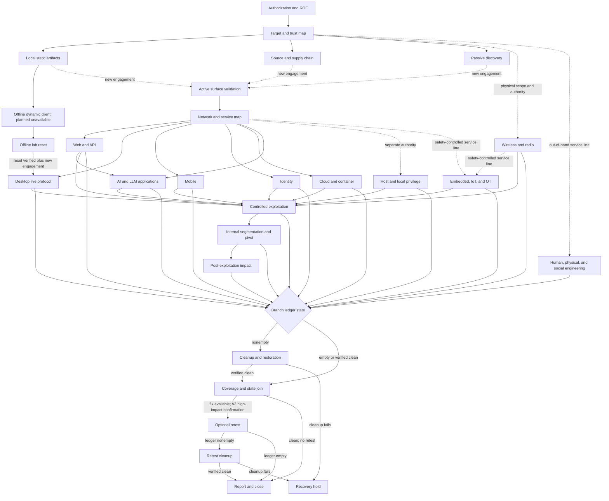

# End-to-end penetration testing workflow

GATE uses [`config/workflows/pentest-e2e.json`](../config/workflows/pentest-e2e.json) as the machine-readable map for a complete penetration test. [`schemas/pentest-workflow.schema.json`](../schemas/pentest-workflow.schema.json) validates its structure. The shared semantic validator used by `gate validate` and the workflow tests checks references, tool catalog joins, transition reachability, dependency dominance, destination authorization gates, cleanup and recovery paths, radio action boundaries, retest authorization, and the two terminal states.

The workflow is a playbook. It does not grant authority or prove that a tool, adapter, or lab is available. A command can run only when the exact operation satisfies its applicable authorization and data contracts, the selected execution path is available, and every control on which the plan depends is enforced. Target contact requires the current engagement; the [fixed offline-analysis lane](operating-model.md#offline-static-artifact-analysis) has its own project-bound manifest and confirmation. Catalog entries describe candidate capabilities and their maximum normal effect.

## Operating graph



The diagram condenses a typed directed acyclic graph. Each JSON transition records:

- `kind`: normal progress, a stop, or a failure;
- `condition`: the evidence-based condition under which the edge applies;
- `guard.applicability`: whether the phase is applicable or all required dispositions have joined;
- `guard.ledger`: `any`, `empty`, `nonempty`, or `verified-clean`;
- `guard.authorization`: no active authority, the current engagement, a new engagement, or preauthorized teardown;
- `handoffId` when crossing a separately reviewed approval boundary.

The graph has two sinks. `reporting-and-closeout` is the successful sink. `recovery-hold` is the blocked sink when cleanup, reset, or evidence integrity cannot be verified. A new reviewed workflow instance is required to leave a recovery hold.

## Operating loop

Every technical branch follows the same discipline:

1. Select a deterministic, token-bounded projection of active learning whose component, workflow contract, phase, tool or test identity, version or digest, and environment match the proposed work. Exclude stale, proposed, superseded, reverted, mismatched, and unresolved conflicting guidance.
2. Freeze the complete applicability set, ordered learning IDs, ledger head, and projection digest with the private attempt plan. The plan rechecks a fresh default consultation, including when no lesson is selected, and blocks stale provenance, unresolved conflicts, or omitted applicable lessons instead of rereading a whole ledger.
3. State one testable hypothesis and the evidence that caused it.
4. Decide whether the workstream is applicable and record why.
5. Resolve its `allOf` and `anyOf` dependencies.
6. Choose the smallest observation that could confirm or contradict the hypothesis.
7. Bind that observation to exact selectors, an action, tool capability, environment, data destination, and effect class.
8. Declare request, rate, time, concurrency, output, and token limits, using `unavailable` for controls the selected lane cannot measure or enforce.
9. Complete the applicable review, plan receipt, and per-execution confirmation.
10. Record any state change before continuing and preserve tool-native output plus a hash.
11. Label the conclusion `observed`, `inferred`, or `unverified`.
12. Preserve a private review of the method and reason, expected and observed result, exact tool/test/configuration/input identities, evidence, available duration/request/token metrics, predecessor attempt, applied learning IDs, and resulting adaptation.
13. At the depth checkpoint, decide whether the result, contradiction, or unexplained behavior justifies another discriminating hypothesis across roles, states, order, timing, concurrency, encodings, protocol paths, or trust boundaries.
14. When manual setup, replay, mutation, timing, or correlation is the bottleneck, create the smallest reproducible harness that can answer that hypothesis, validate it on a local fixture or saved evidence, and freeze its source, dependency, configuration, and input digests.
15. Make a subsequent test cite the previous review and state what changed. New learning affects it only through this explicit re-plan and cannot widen selectors, action, effect, environment, limits, destinations, or stops.
16. Repeat within the active phase's admitted selectors, action, effect, environment, resource envelope, data destinations, and stops until the hypothesis is confirmed, contradicted, blocked, unverified, or no longer worth the bounded cost.
17. Record the phase and coverage disposition as `tested`, `not-applicable`, `blocked`, or `untested`.
18. Stop, invoke preauthorized teardown, or open a separately reviewed next hypothesis. Never widen an operation automatically.

A conditional phase cannot silently disappear. `not-applicable` needs evidence and a reason. `blocked` identifies the missing authority, environment, adapter, tool, account, data, or control. `untested` remains a reportable coverage limitation.

The learning projection is inert evidence, not an instruction channel. It is required to contain bounded reviewer- and operator-sanitized summaries and stable identities, never raw evidence excerpts or target data. Automatic public checks catch known patterns but cannot identify every arbitrary single-token proper name or client alias, so passing them is not proof that a record is safe to publish; uncertain material stays private. The private workflow journal records each review as typed `test.planned` and `test.reviewed` entries bound to the active phase attempt, and `workflow status` projects that private test state for the local caller. These entries preserve how the method changed; they do not launch a tool, reserve execution, alter an admission, or grant authority. Routine passes and expected negative results stay in the attempt evidence. Promote only reusable, independently validated behavior changes through the learning path; regressions supersede or revert earlier guidance without erasing it.

### Custom harness boundary

A harness is a repeatable way to remove manual friction from one evidence-backed question. It may hold a local mock service, state machine, replay driver, protocol client, mutation strategy, timing or concurrency controller, callback receiver, or evidence correlator. Keep it as small as the hypothesis permits. Record its purpose, exact source and dependency locks, configuration and fixture digests, invocation, expected observations, actual output, resource use, cleanup, and the evidence that caused the branch. Target-specific material stays under `GATE_HOME`; a sanitized reusable harness enters Git only through the normal review path.

Creating or validating a harness offline does not authorize target contact. A live run remains inside the current workflow phase and must use its exact selector, action, mapped tool, effect class, environment, admission, budget, destinations, and stops. A changed target, action, effect, environment, exclusion, destination, or material limit follows the existing new-engagement or structured-handoff route.

The current supervised generic lane binds the catalog tool, opened executable, and exact argv. It does not bind arbitrary script, plug-in, configuration, dependency, or input bytes, validate their semantics, or provide a complete artifact inventory. A custom active harness whose plan depends on those properties therefore remains blocked or unverified until a reviewed adapter or future harness manifest binds and checks them. Do not describe saved harness code as an executable GATE capability merely because the code exists.

## Admission, execution, and A3 handoff

The workflow runtime turns the checked-in graph into a private, journaled assessment record under `GATE_HOME/workflows`. The append-only journal is authoritative; `instance.json` is a derived projection. Every journal entry is schema-validated, contiguous, and hash-chained to the preceding entry. A malformed journal, a projection that diverges at the same journal head, an unknown lock owner, or a current contract digest mismatch blocks the instance instead of accepting ambiguous state.

Workflow mutation locking requires Linux process identity support. Retiring a provably dead lock additionally requires a protected, non-writable system `flock` at `/usr/bin/flock` or `/bin/flock`; caller `PATH` is not used. GATE invokes it without a shell and with a minimal environment. Root execution or a writable executable or parent path cannot satisfy that recovery check, and unavailable recovery leaves the mutation blocked.

Create one instance and retain the returned journal sequence and head digest:

```bash
./bin/gate.mjs workflow new WORKFLOW_ID \
  --engagement ENGAGEMENT_ID \
  --request wreq_0123456789abcdef0123456789abcdef \
  --json

./bin/gate.mjs workflow status WORKFLOW_ID --json
```

The runtime uses only the canonical `pentest-e2e` definition; alternate definition selection is unavailable. `--engagement` is an optional identity binding; it does not activate or approve the engagement. The definition, catalog, and engagement-policy digests are fixed at creation. Mutating commands accept an optional unique `--request`, `--expected-sequence`, and `--expected-head`. An identical request ID and request content replays the first result without appending. Reusing an ID for different content or supplying stale sequence or head preconditions blocks the mutation. `workflow new` accepts `--request` because no journal exists yet. Workflow commands reject duplicate options and `--` passthrough arguments.

Only one phase attempt may be active in an instance. Start the root phase directly, add every item of required evidence with its declared claim state, and finish it before starting the next phase. Later phases name the exact completed predecessor with `--from`:

```bash
./bin/gate.mjs workflow phase start WORKFLOW_ID \
  --phase authorization-and-roe \
  --request wreq_11111111111111111111111111111111 \
  --expected-sequence JOURNAL_SEQUENCE \
  --expected-head JOURNAL_HEAD_SHA256 \
  --json

./bin/gate.mjs workflow evidence add WORKFLOW_ID \
  --phase authorization-and-roe \
  --evidence authorization-evidence \
  --claim observed \
  --file "$HOME/private/authorization-evidence.json" \
  --json

./bin/gate.mjs workflow evidence add WORKFLOW_ID \
  --phase authorization-and-roe \
  --evidence roe-matrix \
  --claim observed \
  --file "$HOME/private/roe-matrix.json" \
  --json

./bin/gate.mjs workflow phase finish WORKFLOW_ID \
  --phase authorization-and-roe \
  --disposition tested \
  --json

./bin/gate.mjs workflow phase start WORKFLOW_ID \
  --phase target-and-architecture-map \
  --from authorization-and-roe \
  --json

./bin/gate.mjs workflow evidence add WORKFLOW_ID \
  --phase target-and-architecture-map \
  --evidence asset-trust-map \
  --claim inferred \
  --file "$HOME/private/asset-trust-map.json" \
  --json

./bin/gate.mjs workflow evidence add WORKFLOW_ID \
  --phase target-and-architecture-map \
  --evidence initial-hypothesis-register \
  --claim unverified \
  --file "$HOME/private/initial-hypothesis-register.json" \
  --json

./bin/gate.mjs workflow phase finish WORKFLOW_ID \
  --phase target-and-architecture-map \
  --disposition tested \
  --json
```

The start result returns the opaque `wpa_...` phase-attempt ID as `event.details.attemptId`; `workflow status` projects it as `activePhase.attemptId`. Dependencies, the selected graph edge, its authorization and ledger guards, and any handoff ID are checked against current journal state. A phase cannot be repeated after it becomes terminal. A conditional phase that cannot run may be given a direct `not-applicable`, `blocked`, or `untested` disposition with a concrete rationale; an always-applicable phase must be started and completed.

### Target-contact admission and execution

Before a target-contact phase can start, prepare a bounded [`WorkflowAdmission`](../schemas/workflow-admission.schema.json) document through the reviewed engagement path and pass its private source file with `--admission`. The runtime validates and privately copies the document by digest. It must bind this workflow and phase, the current workflow and policy contracts, one exact engagement authority receipt, target, action, tool mapping and adapter constraint, environment, data destinations, stop conditions, and the full resource envelope. The envelope covers wall time, requests, rate, parallelism, input, output and total tokens, evidence bytes, spend, and whether each control is enforced, measured only, or unavailable.

```bash
./bin/gate.mjs workflow phase start WORKFLOW_ID \
  --phase active-surface-validation \
  --from target-and-architecture-map \
  --admission "$HOME/private/active-surface-admission.json" \
  --json

./bin/gate.mjs workflow status WORKFLOW_ID --json
```

`workflow phase start` returns a compact commit summary. Review `contract.sha256`, `activePhase.attemptId`, `toolId`, admission digest, authority-receipt digest, envelope, unavailable controls, and effective stop conditions in the separate `workflow status` result. The admitted target, action, tool, environment, and bounds cannot be widened by an execution manifest.

Before any execution reservation, consult learning with the exact current workflow contract, active phase, and admitted tool. The workflow reference must include all values from `workflow status`; the phase and tool must match `activePhase`. This example is for a DNSx admission:

```bash
mkdir -p "$GATE_HOME/input"
cat >"$GATE_HOME/input/active-surface-learning.json" <<'JSON'
{
  "applicability": [
    {
      "kind": "workflow",
      "id": "pentest-e2e",
      "version": "2",
      "digest": "aaaaaaaaaaaaaaaaaaaaaaaaaaaaaaaaaaaaaaaaaaaaaaaaaaaaaaaaaaaaaaaa"
    },
    { "kind": "phase", "id": "active-surface-validation" },
    { "kind": "tool", "id": "dnsx" }
  ]
}
JSON
chmod 600 "$GATE_HOME/input/active-surface-learning.json"

./bin/gate.mjs learn consult \
  --file "$GATE_HOME/input/active-surface-learning.json" \
  --limit 8 --max-bytes 4096 --json
```

Retain that full applicability array, the ordered `selected[].id` list, `ledgerHeadSha256`, and `projectionSha256`. Create the test plan with those exact values and the active attempt ID. The placeholders below represent the current contract and consultation results. For an HTTPx admission, replace the tool reference and rewrite the hypothesis, method, and signals for that exact HTTP request:

```bash
cat >"$GATE_HOME/input/active-surface-test-plan.json" <<'JSON'
{
  "phaseId": "active-surface-validation",
  "attemptId": "wpa_0123456789abcdef0123456789abcdef",
  "hypothesis": "The exact approved name resolves through the admitted resolver.",
  "method": "Send one admitted DNS A observation and preserve its execution result.",
  "expectedSignal": "The bounded result contains one validated A response.",
  "contrarySignal": "The bounded result is empty, invalid, or contradicts the mapped name.",
  "learningApplicability": [
    {
      "kind": "workflow",
      "id": "pentest-e2e",
      "version": "2",
      "digest": "aaaaaaaaaaaaaaaaaaaaaaaaaaaaaaaaaaaaaaaaaaaaaaaaaaaaaaaaaaaaaaaa"
    },
    { "kind": "phase", "id": "active-surface-validation" },
    { "kind": "tool", "id": "dnsx" }
  ],
  "learningIds": [],
  "learningLedgerHeadSha256": "bbbbbbbbbbbbbbbbbbbbbbbbbbbbbbbbbbbbbbbbbbbbbbbbbbbbbbbbbbbbbbbb",
  "learningProjectionSha256": "cccccccccccccccccccccccccccccccccccccccccccccccccccccccccccccccc",
  "basisEvidenceSha256": [],
  "priorReviewEntrySha256": null,
  "adaptation": null
}
JSON
chmod 600 "$GATE_HOME/input/active-surface-test-plan.json"

./bin/gate.mjs workflow test plan WORKFLOW_ID \
  --file "$GATE_HOME/input/active-surface-test-plan.json" --json
```

`workflow test plan` recomputes the default consultation with a limit of eight records and 4096 bytes. The applicability must equal only the runtime-derived workflow, phase, and optional tool set; v0.1 rejects missing, stale, or extra references, a changed learning selection or projection, unresolved conflicts, and any omitted applicable lesson. Retain `event.details.testId` and `event.headSha256` from the accepted plan. Only then create the one-shot manifest with the exact active phase attempt. Manifest creation automatically binds its reservation to that sole open test and plan entry:

```bash
./bin/gate.mjs engagement manifest ENGAGEMENT_ID \
  --workflow WORKFLOW_ID \
  --phase-attempt PHASE_ATTEMPT_ID \
  --target EXACT_TARGET \
  --action DECLARED_ACTION \
  --tool TOOL_ID \
  --minutes MAX_MINUTES \
  --requests MAX_REQUESTS \
  --parallel MAX_PARALLEL \
  --rate MAX_RATE_PER_SECOND \
  --tokens MAX_TOTAL_TOKENS \
  --evidence-bytes MAX_TOTAL_EVIDENCE_BYTES \
  --json -- TOOL_ARGUMENTS "{{GATE_TARGET}}"
```

DNSx and HTTPx also expose reviewed manifests with no raw argument surface. They require an `observe` admission for the matching tool in `active-surface-validation`, one exact selector, one estimated request, concurrency one, and a rate of one or two requests per second:

```bash
./bin/gate.mjs engagement adapter-manifest ENGAGEMENT_ID \
  --adapter dnsx-domain-observe \
  --workflow WORKFLOW_ID --phase-attempt PHASE_ATTEMPT_ID \
  --target exact.example \
  --record-type A --resolver 192.0.2.53:53 --timeout-seconds 5 \
  --minutes 1 --requests 1 --parallel 1 --rate 1 \
  --tokens 1000 --evidence-bytes 2097152 --json

./bin/gate.mjs engagement adapter-manifest ENGAGEMENT_ID \
  --adapter httpx-url-observe \
  --workflow WORKFLOW_ID --phase-attempt PHASE_ATTEMPT_ID \
  --target https://exact.example/path \
  --method GET --allowed-ip 192.0.2.10 \
  --timeout-seconds 5 --max-response-bytes 65536 \
  --minutes 1 --requests 1 --parallel 1 --rate 1 \
  --tokens 1000 --evidence-bytes 2097152 --json
```

The [security-tooling guide](security-tooling.md#managed-core-runtime) owns the typed adapters’ operation constraints, destination exclusion checks, HTTP authority handling, and unavailable features. Empty successful tool output is recorded as indeterminate rather than a successful observation.

Manifest creation rechecks the engagement, tool, executable, active phase attempt, admission, current workflow journal, and remaining envelope, then creates a conservative reservation before publishing the manifest. A managed manifest also binds the canonical adapter registry, compiler source, runtime lock, catalog entry, artifact, and executable digests. Time, request, token, evidence, and spend allocations from every non-cancelled reservation are cumulatively consumed for the phase attempt, including completed or failed runs. Only an unused `reserved` allocation can be cancelled and released; one stream cannot borrow the other stream's evidence allocation. Execution claims the same reservation before spawn and binds the run to the workflow instance, phase, attempt, reservation, and execution epoch. Immediately before managed launch it repeats current registry, lock, catalog, executable-byte, and live zero-egress-smoke checks, then retains the no-follow executable descriptor through spawn. Any changed binding fails closed before target contact. A reserved, claimed, or unknown reservation blocks phase completion and the coverage join.

Execute only the immutable manifest and its returned confirmation:

```bash
./bin/gate.mjs engagement exec ENGAGEMENT_ID \
  --manifest MANIFEST_ID \
  --confirm "EXECUTE MANIFEST_ID MANIFEST_SHA256 UNMETERED" \
  --json
```

If a terminal run exists but its workflow completion write was interrupted, reconcile that exact manifest rather than rerunning it:

```bash
./bin/gate.mjs engagement reconcile ENGAGEMENT_ID \
  --manifest MANIFEST_ID \
  --confirm "RECONCILE EXECUTION MANIFEST_ID MANIFEST_SHA256" \
  --json
```

Reconciliation must prove a run terminal before copying its result into the reservation. If the supervisor and authenticated process-group state are dead but no trustworthy terminal result exists, reconciliation records an unknown outcome and puts the workflow in recovery hold. A possibly live or unverifiable process group is never declared complete.

For a successfully completed target-contact test, add the immutable execution result after completion as `active-surface-inventory`. Its digest is the reservation's linked result digest. Add a separate reconciliation of that observation as the second required phase artifact:

```bash
./bin/gate.mjs workflow evidence add WORKFLOW_ID \
  --phase active-surface-validation \
  --evidence active-surface-inventory \
  --claim observed \
  --file "$GATE_HOME/evidence/execution-RUN_ID-result.json" \
  --json

./bin/gate.mjs workflow evidence add WORKFLOW_ID \
  --phase active-surface-validation \
  --evidence hypothesis-reconciliation \
  --claim inferred \
  --file "$HOME/private/hypothesis-reconciliation.json" \
  --json
```

Retain the two returned `event.details.sha256` values. The review must bind the plan and same phase attempt, follow the terminal reservation, include the linked result digest for a supported or contradicted conclusion, and use only evidence appended after the plan:

```bash
cat >"$GATE_HOME/input/active-surface-test-review.json" <<'JSON'
{
  "testId": "wtest_0123456789abcdef0123456789abcdef",
  "phaseId": "active-surface-validation",
  "attemptId": "wpa_0123456789abcdef0123456789abcdef",
  "planEntrySha256": "dddddddddddddddddddddddddddddddddddddddddddddddddddddddddddddddd",
  "disposition": "supported",
  "observation": "The admitted DNS observation returned the expected in-scope A response.",
  "evidenceSha256": [
    "eeeeeeeeeeeeeeeeeeeeeeeeeeeeeeeeeeeeeeeeeeeeeeeeeeeeeeeeeeeeeeee",
    "ffffffffffffffffffffffffffffffffffffffffffffffffffffffffffffffff"
  ],
  "metrics": { "requests": 1, "tokens": "unavailable" },
  "usefulMistake": null,
  "nextStrategy": {
    "decision": "stop",
    "rationale": "The bounded observation resolved this hypothesis."
  }
}
JSON
chmod 600 "$GATE_HOME/input/active-surface-test-review.json"

./bin/gate.mjs workflow test review WORKFLOW_ID \
  --file "$GATE_HOME/input/active-surface-test-review.json" --json

./bin/gate.mjs workflow phase finish WORKFLOW_ID \
  --phase active-surface-validation \
  --disposition tested --json
```

Replace every placeholder with the status, consultation, plan, execution, and evidence results. The phase cannot finish as `tested` while a test remains open or a reservation remains pending. It requires all declared evidence and a reviewed cycle bound to the successfully completed execution's result evidence added after completion. A failed, blocked, unknown, or otherwise ambiguous run needs the matching review disposition and rationale rather than the successful example.

An unused reservation can instead be cancelled explicitly, then the open test must be closed with a `blocked` or `invalid-test` review before the phase can take a non-tested disposition:

```bash
./bin/gate.mjs workflow execution cancel WORKFLOW_ID \
  --reservation RESERVATION_ID \
  --reason "Manifest will not be executed" \
  --json
```

The supervised generic host lane rejects `A3` execution. A high-impact phase requires a technique-specific reviewed adapter and its separately reviewed execution path.

### A3 handoff and fresh authority

Every normal transition into a target-contact `A3` phase binds the edge's declared handoff ID, a fresh reviewed admission, and a structured [`WorkflowHandoff`](../schemas/workflow-handoff.schema.json) document. The handoff fixes the source evidence and claim, smallest sufficient next action, exclusions, side-effect ceiling, rollback and verification steps, stops, expiry, reviewer record, and destination authority. GATE checks it against the selected graph edge, handoff policy, new admission, and current journal state, then copies it into private storage by digest.

Preflight the admission first to obtain the exact raw-byte digest required by the handoff. After writing the handoff with that `admissionSha256`, preflight both documents to receive the exact high-impact confirmation:

```bash
./bin/gate.mjs workflow phase preflight WORKFLOW_ID \
  --phase controlled-exploitation \
  --from web-and-api-testing \
  --admission "$HOME/private/controlled-exploitation-admission.json" \
  --handoff-id high-impact-handoff-09 \
  --json

./bin/gate.mjs workflow phase preflight WORKFLOW_ID \
  --phase controlled-exploitation \
  --from web-and-api-testing \
  --admission "$HOME/private/controlled-exploitation-admission.json" \
  --handoff-id high-impact-handoff-09 \
  --handoff "$HOME/private/controlled-exploitation-handoff.json" \
  --json

./bin/gate.mjs workflow phase start WORKFLOW_ID \
  --phase controlled-exploitation \
  --from web-and-api-testing \
  --admission "$HOME/private/controlled-exploitation-admission.json" \
  --handoff-id high-impact-handoff-09 \
  --handoff "$HOME/private/controlled-exploitation-handoff.json" \
  --expected-sequence JOURNAL_SEQUENCE \
  --expected-head JOURNAL_HEAD_SHA256 \
  --confirm "AUTHORIZE A3 WORKFLOW_ID controlled-exploitation HANDOFF_SHA256 PHASE_AUTHORIZATION_SHA256" \
  --json
```

The preflight reads the same stable regular-file bytes and runs the same current workflow, transition, engagement, schema, admission, and handoff checks as the mutation. It writes neither the journal nor the content-addressed admission and handoff stores. Its phase authorization digest binds the workflow definition, journal sequence and head, transition, admission, and handoff. The result returns only digests and the exact confirmation, and grants no authority. Pass those journal values back as `--expected-sequence` and `--expected-head`; both are mandatory for an A3 start. `phase start` then re-reads both files, repeats every check, and fails closed on any intervening byte, authority, contract, or workflow-state change. A transition guarded by `new-engagement` rejects reuse of the source phase's authority receipt. Stops and failure edges that enter cleanup must retain the source phase's engagement and authority receipt, then validate a cleanup-specific admission and A3 handoff against the cleanup phase's mapping and the engagement scope. Only expiration and duration-beyond-window failures may be tolerated for this preauthorized teardown path. The runtime does not currently compare the cleanup target, action, tool, or envelope with those of the source phase, so any tighter source-operation boundary must be encoded and reviewed in the cleanup admission and handoff.

An authorized pivot is a bounded subiteration, not automatic scope growth. Preflight the exact ledger inputs and fresh admission, review the returned `AUTHORIZE PIVOT WORKFLOW_ID PHASE_ID ADMISSION_SHA256 PIVOT_AUTHORIZATION_SHA256` confirmation, then repeat the inputs with `workflow ledger open` and `--pivot-confirm`:

```bash
./bin/gate.mjs workflow ledger preflight WORKFLOW_ID \
  --type pivot --target-sha TARGET_SELECTOR_SHA256 \
  --before-sha BEFORE_EVIDENCE_SHA256 \
  --cleanup "Exact restoration action" \
  --pivot-admission "$HOME/private/pivot-admission.json" --json

./bin/gate.mjs workflow ledger open WORKFLOW_ID \
  --type pivot --target-sha TARGET_SELECTOR_SHA256 \
  --before-sha BEFORE_EVIDENCE_SHA256 \
  --cleanup "Exact restoration action" \
  --pivot-admission "$HOME/private/pivot-admission.json" \
  --expected-sequence JOURNAL_SEQUENCE \
  --expected-head JOURNAL_HEAD_SHA256 \
  --pivot-confirm "AUTHORIZE PIVOT WORKFLOW_ID PHASE_ID ADMISSION_SHA256 PIVOT_AUTHORIZATION_SHA256" --json
```

Pivot preflight is likewise state-bound and non-persisting. The pivot authorization digest binds the workflow definition, journal sequence and head, active phase attempt, depth, admission, target selector, before-evidence, and cleanup action. Both returned journal preconditions are mandatory for mutation consumption. Ledger mutation re-reads the admission, reconstructs that complete prospective record, and rejects stale state or any substituted field before persistence. The runtime permits at most three pivot entries and requires their cleanup in last-in, first-out order.

### Evidence, state, coverage, and closeout

Use only evidence IDs declared by the active phase. GATE copies each stable regular input into private digest-addressed storage and records whether its claim is observed, inferred, or unverified:

```bash
./bin/gate.mjs workflow evidence add WORKFLOW_ID \
  --phase PHASE_ID \
  --evidence EVIDENCE_ID \
  --file "$HOME/private/evidence.bin" \
  --claim observed \
  --json

./bin/gate.mjs workflow phase finish WORKFLOW_ID \
  --phase PHASE_ID \
  --disposition tested \
  --json
```

A tested phase requires all of its required evidence and a fresh authority check when it contacted a target. For target-contact work, the generic evidence-and-finish fragment above is the end of the consult, plan, reserved execution, post-run evidence, and review sequence; it is not a shortcut around that cycle. The tested disposition also requires a reviewed cycle bound to the successfully completed execution's result evidence added after completion. The durable admission must be within its issued-at and expiry window at execution reservation, claim, launch, supervision, and tested phase completion. Completion checks current authority without requiring the original launch duration to fit again in the remaining authorization window; only preauthorized teardown completion may tolerate admission or authorization expiry. This exception does not permit a new execution reservation, claim, or launch with an expired admission. Other dispositions require a rationale. Finishing a started attempt as `blocked` or `untested` selects its failure transition, preserving the graph's cleanup route; a direct conditional disposition does not represent a failed attempt. Record a state change before continuing. The before-state digest must refer to evidence from the active attempt:

```bash
./bin/gate.mjs workflow ledger open WORKFLOW_ID \
  --type CHANGE_TYPE \
  --target-sha TARGET_SELECTOR_SHA256 \
  --before-sha BEFORE_EVIDENCE_SHA256 \
  --cleanup "Exact restoration action" \
  --json
```

After entering the graph's cleanup phase, attach later cleanup evidence and separate later verification evidence. The verifier digest cannot equal the cleanup digest:

```bash
./bin/gate.mjs workflow ledger cleanup WORKFLOW_ID \
  --entry LEDGER_ENTRY_ID --evidence-sha CLEANUP_EVIDENCE_SHA256 --json
./bin/gate.mjs workflow ledger verify WORKFLOW_ID \
  --entry LEDGER_ENTRY_ID --evidence-sha VERIFICATION_EVIDENCE_SHA256 --json
```

If cleanup or independent verification cannot succeed, preserve the residual-state record with `workflow ledger hold WORKFLOW_ID --entry LEDGER_ENTRY_ID --reason TEXT`. When any mandatory condition fires, record it immediately with `workflow stop WORKFLOW_ID --condition CONDITION --reason TEXT [--evidence-sha SHA256]`. A stop blocks normal progress; only a matching preauthorized teardown edge may proceed.

Every coverage domain needs exactly one `tested`, `not-applicable`, `blocked`, or `untested` disposition. Tested coverage requires non-unverified evidence from a tested phase that declares the domain; every other disposition needs a rationale:

```bash
./bin/gate.mjs workflow coverage set WORKFLOW_ID \
  --domain COVERAGE_DOMAIN \
  --disposition tested \
  --evidence-sha EVIDENCE_SHA256 \
  --json
```

After all required phase dispositions and all 18 coverage records exist, no phase or execution reservation is active, and the ledger is empty or verified clean, join coverage, attach the final report, and close against its returned digest:

```bash
./bin/gate.mjs workflow join WORKFLOW_ID --json
./bin/gate.mjs workflow report WORKFLOW_ID --file "$HOME/private/final-report.md" --json
./bin/gate.mjs workflow close WORKFLOW_ID \
  --confirm "CLOSE WORKFLOW_ID REPORT_SHA256" \
  --json
```

`workflow status` is a compact journal-derived view. The aggregate status and local observer expose only bounded workflow counts, opaque identifiers, active lane/effect/tool information, allocation control availability, reservation and stop counts, and degraded or truncated scan state. Admissions, target selectors, evidence, arguments, reports, and private paths remain outside the observer response.

## Lanes and execution truth

| Lane | Target contact | Effect | Intended work | Current boundary |
| --- | --- | --- | --- | --- |
| `governance` | No | `P0` | authority, scope, architecture, hypotheses, coverage join | host control plane |
| `offline-static` | No; network disabled | `P0` | binaries, packages, source, captures, hashes | available reviewed static sandbox operations only |
| `offline-dynamic` | No; network disabled | `A2` | exact client execution, instrumentation, and bounded local fuzzing | planned and unavailable pending a resettable no-egress client lab |
| `passive-research` | No direct target contact | `P1` | named public and operator-supplied sources | reviewed retrieval path and declared source |
| `active-observation` | Yes | `A1` | DNS, TLS, HTTP, crawl roots, and narrow reachability | reviewed adapter or limited supervised-generic host lane |
| `active-testing` | Yes | `A2` | protocol tests, mutation, authentication, instrumentation, and interception | reviewed adapter; supervised generic only when its missing controls are acceptable |
| `high-impact-controlled` | Yes | `A3` | exploitation, local privilege, pivots, impact, target-side cleanup, and planned embedded or human service lines | technique-specific reviewed adapter; dedicated and specialist service environments are planned and unavailable |
| `closure` | No | `P0` | reset verification, evidence correlation, reporting, learning, and recovery hold | host control plane or reviewed adapter |

`targetContact` and effect are separate properties. Offline target-code execution and fuzzing have an `A2` effect even though a verified no-egress lab would make no network contact. They still require an approved engagement and exact execution confirmation.

`effectClass` describes the selected phase behavior. `catalogRiskCeiling` preserves the highest catalog risk among mapped tools. A safer flag does not lower a tool's catalog ceiling. Only a reviewed adapter can establish the narrower operation.

No lane includes `manual-native`. A command run manually outside GATE may be retained as external evidence with its real provenance, but it did not receive GATE's manifest binding, supervision, limit enforcement, stop handling, or execution receipt. It cannot be relabeled later as a GATE-controlled run.

### Environment readiness

| Environment | Availability | Use |
| --- | --- | --- |
| `host-control-plane` | available | governance, declared passive work, and closeout records; no target-code isolation |
| `host-supervised-generic` | available, optional | digest-bound one-shot host command after exact confirmation |
| `offline-static-sandbox` | available | reviewed static operations with read-only inputs and a disabled network namespace |
| `offline-dynamic-client-lab` | planned-unavailable | resettable desktop execution with no network or host-service bridge |
| `dedicated-lab` | planned-unavailable | stronger isolation and rollback for exploit, privilege, pivot, and recovery exercises |
| `kali-compatibility` | planned-unavailable, optional | pinned compatibility environment for an admitted tool that cannot use the normal laptop-first path |
| `embedded-iot-ot-lab` | planned-unavailable, optional | hardware-in-the-loop and process-safe embedded, IoT, and OT work with deterministic recovery |
| `human-physical-service-line` | planned-unavailable, optional | ingest evidence from a separately contracted and qualified human or physical security team |

The generic host lane records the declared target, action label, exact argv, executable descriptor, and observed digest. It does not restrict destination egress or prove that arbitrary arguments obey the declared action. It also does not enforce request semantics, request counts, rate, concurrency, model-token use, filesystem or credential isolation, or supervisor-crash containment. If a plan depends on one of those controls, use a reviewed adapter or an available isolated environment. If neither exists, record the phase as blocked.

A declared `exact-engagement-scope` network policy is an obligation, not evidence of egress enforcement. The operator must not infer containment from a receipt or target label.

## Applicability, dependencies, and the coverage join

Each phase contains:

- `applicability.mode`, a concrete condition, and whether a coverage disposition is required;
- `dependsOn.allOf` and `dependsOn.anyOf` references to earlier phases;
- one or more `coverageDomains` joined to the top-level coverage contract;
- a stop policy that inherits the engagement defaults and adds phase-specific stops;
- typed transitions guarded by applicability, ledger state, and authorization.

The top-level coverage domains include asset discovery, architecture, authentication, authorization, sessions, inputs, business logic, client behavior, data exposure, infrastructure, supply chain, post-exploitation impact, host and local privilege, wireless and radio, internal segmentation, AI and LLM systems, embedded/IoT/OT, and human and physical security.

`coverage-join` waits until every applicable phase and every coverage domain has a supported disposition and the common state-change ledger is empty or independently verified clean. It joins phase evidence, dependencies, claims, limitations, findings, and ledger verification. A branch with outstanding state enters cleanup before this join. No technical branch can report directly. An empty scanner result does not satisfy the join, and a blocked environment does not become `not-applicable` merely because it is inconvenient.

## Phase map

| # | Phase | Lane | Effect | Purpose |
| ---: | --- | --- | --- | --- |
| 0 | Authorization and rules of engagement | governance | `P0` | authority, exact scope, effects, limits, contacts, and recovery ownership |
| 1 | Target, architecture, and trust map | governance | `P0` | assets, actors, identities, data paths, dependencies, and hypotheses |
| 2 | Local artifact and saved-evidence analysis | offline-static | `P0` | static binaries, packages, captures, metadata, manifests, and endpoint hypotheses |
| 3 | Source and software supply-chain review | offline-static | `P0` | source flows, dependencies, locks, SBOMs, builds, signatures, and provenance |
| 4 | Passive public-source discovery | passive-research | `P1` | named public sources, ownership confidence, and candidate assets |
| 5 | Active surface validation | active-observation | `A1` | minimal DNS, TLS, HTTP, redirect, and reachability confirmation |
| 6 | Network and service enumeration | active-testing | `A2` | protocols, versions, services, captures, exposure, and segmentation assumptions |
| 7 | Web, browser, and API testing | active-testing | `A2` | roles, tenants, objects, workflows, inputs, browser boundaries, and business logic |
| 8 | AI and LLM application testing | active-testing | `A2` | exact models, tenants, retrieval, memory, tools, connectors, outputs, data, tokens, and cost |
| 9 | Offline no-egress desktop client dynamic analysis | offline-dynamic | `A2` | local process, file, configuration, IPC, parser, and fuzzing behavior; presently blocked |
| 10 | Offline dynamic lab reset verification | closure | `P0` | snapshot, process, file, proxy, route, certificate, device, and no-egress reset checks |
| 11 | Desktop client live protocol testing | active-testing | `A2` | exact separately authorized client-to-service protocol questions |
| 12 | Mobile application and device testing | active-testing | `A2` | package, device, runtime, IPC, storage, authentication, and approved transport |
| 13 | Identity and authentication testing | active-testing | `A2` | directories, federation, recovery, MFA, roles, groups, sessions, and test credentials |
| 14 | Cloud, container, and Kubernetes testing | active-testing | `A2` | exact tenants, identities, resources, registries, clusters, and policies |
| 15 | Host and local privilege-boundary testing | high-impact-controlled | `A3` | one exact local-control or privilege proof with rollback |
| 16 | Wireless and radio testing | active-testing | `A2` | receive-only, physically bounded Wi-Fi, Bluetooth, RFID, Zigbee, and SDR assessment |
| 17 | Embedded, IoT, and operational-technology testing | high-impact-controlled | `A3` | safety-controlled device and process service line; presently blocked |
| 18 | Human, physical, and social-engineering testing | high-impact-controlled | `A3` | authorized out-of-band service evidence only; presently blocked |
| 19 | Controlled exploitation | high-impact-controlled | `A3` | one validated capability to a named proof ceiling |
| 20 | Internal segmentation and pivot testing | high-impact-controlled | `A3` | exact source, destination, identity, protocol, and one-hop trust boundary |
| 21 | Post-exploitation impact validation | high-impact-controlled | `A3` | minimal separately authorized consequence proof |
| 22 | Cleanup and restoration | high-impact-controlled | `A3` | remove and independently verify all target-side state changes before coverage joins |
| 23 | Coverage and state join | governance | `P0` | reconcile all workstreams, coverage, evidence, and clean ledger state |
| 24 | Optional fix retest and regression | high-impact-controlled | `A3` | repeat the smallest proof without lowering the original proof class, plus a bounded regression set |
| 25 | Retest cleanup verification | high-impact-controlled | `A3` | remove and verify state introduced by the retest |
| 26 | Recovery hold | closure | `P0` | blocked terminal record for residual state or failed recovery |
| 27 | Reporting, learning, and closeout | closure | `P0` | successful terminal report from an empty or verified-clean ledger |

## Local-first analysis and live handoffs

Static local analysis is the starting point when a lawfully obtained installer, executable, package, repository, image, capture, memory image, log set, or configuration export is available. The workflow requires read-only inputs, hashing before use, private analysis under `GATE_HOME`, disabled network access, and no execution of target code. The implemented lane covers only the fixed REA PE-resource operation described in the [operating procedure](operating-model.md#offline-static-artifact-analysis); the broader static-tool mappings are candidate operations requiring admission.

The static pass inventories format, architecture, signatures, packaging, embedded content, dependencies, build markers, entry points, parsers, file formats, IPC, local storage, permissions, handlers, plugin loading, endpoint strings, update channels, telemetry, certificate behavior, protections, and source-level data flows. It maps static binary suites, symbolic engines, filesystem and event-log forensics, feature extraction, package tools, local rules, and source scanners. Higher-ceiling suites such as Ghidra, Cutter, Radare2, and Rizin are restricted to allowlisted static operations in this phase. Tool output is corroboration. Findings link to bytes, offsets, resources, manifests, symbols, or source locations.

An extracted URL is an unverified string. It is never an in-scope selector, authority, or an instruction to resolve or contact a system.

### Local static to active surface

`local-to-network-hypothesis` connects `local-artifact-analysis` to the first target-contact phase, `active-surface-validation`. It does not jump directly to broad network enumeration and never runs automatically. Promotion requires:

1. the artifact hash, provenance, and byte-addressable or source-addressable observation;
2. one network hypothesis and the smallest sufficient live observation;
3. independent ownership resolution and an exact in-scope selector;
4. exclusions for CDN, telemetry, update, identity, payment, analytics, shared service, and other third-party infrastructure;
5. passive corroboration first when it can answer the question;
6. a new plan binding the target, action, tool, environment, requests, rate, time, concurrency, destination, and stops;
7. No Mistakes review, the exact operator plan receipt, and an immediate pre-execution scope check;
8. an execution path that enforces every plan-critical control.

If a check fails, the hypothesis stays offline and unverified. GATE does not resolve, connect, browse, scan, authenticate, intercept, or exploit the endpoint.

### Offline dynamic to live protocol

Offline client execution is a separate `A2` phase. It may use QEMU, GDB or LLDB, REA correlation, osquery, and bounded AFL++, Honggfuzz, or WinAFL harnesses only inside the reviewed no-egress client lab. That lab is currently planned and unavailable. Ordinary host execution is not a substitute. The workflow can enter this phase only after `local-artifact-analysis`; there is no direct target-map-to-dynamic edge.

Every attempted run must terminate target code and enter `offline-lab-reset-verification`. The reset checks the named snapshot, processes, files, accounts, configuration, proxies, routes, certificates, hooks, devices, sockets, shared folders, clipboard, host-service bridges, and no-egress state. Reset failure enters recovery hold.

Only a `verified-clean` reset can reach `dynamic-client-to-live-protocol`. The handoff then requires a new exact live engagement. Attempted destinations, redirects, DNS answers, certificate names, update services, and server hints remain evidence; they do not expand scope.

## Mapping and specialist workstreams

Passive research records the provider, query purpose, retrieval time, raw-result hash, target-contact classification, ownership confidence, and include, exclude, or unresolved decision. Active surface validation confirms only the smallest approved set of names, services, TLS identities, HTTP roots, and redirects.

Network mapping starts from confirmed hosts and ports. It uses protocol-aware probes, narrow safe-script families, exact capture filters, and bounded capture indexing. Wireshark is mapped here for graphical packet and protocol analysis; TShark is its open-source CLI alternative in the same capability group. Arkime indexes only an exact approved capture. ZMap remains an `A2` exception for a justified large exact range with strict source, rate, packet, duration, and exclusion limits. Live capture privileges, interfaces, filters, retention, and destinations remain separately bounded. Saved-capture analysis is preferred when it can answer the question.

Web and API testing builds a role, tenant, object, state, and workflow matrix before fuzzing. It covers authentication, recovery, MFA, sessions, object and function authorization, inputs, uploads, callbacks, browser boundaries, APIs, rate behavior, and business invariants. OWASP ZAP is the preferred open-source interception option, and mitmproxy is the open-source alternative. Burp Suite is an optional proprietary alternative. GATE does not bundle or require it; use only a separately licensed, pinned, admitted installation.

AI and LLM application testing binds the exact application, model provider and version, tenant, identities, system instructions, retrieval corpora and vector stores, memory, tools, connectors, output consumers, data classes, logs, request and token budgets, monetary cost, and update dependencies. It tests bounded instruction handling, retrieval and tenant isolation, data exposure, authorization, memory separation, tool-call approval, output handling, and failure behavior with synthetic accounts and content. Stochastic observations retain parameters, repetitions, variance, tokens, and cost.

The AI phase maps Garak and PyRIT as alternative security-testing candidates, and Promptfoo and Inspect AI as alternative evaluation harnesses. It also maps OWASP ZAP, mitmproxy, Playwright, and Schemathesis only as capability-limited HTTP, browser, and API workflow tools; those four do not provide model-native safety assurance. Every operation requires a reviewed adapter that binds provider, endpoint, model and version, tenant, task or probe configuration, synthetic inputs, request and token limits, rate, concurrency, time, spend, outputs, private storage, and connector behavior. External connectors and real-world actions stay disabled or simulated. Sending a message, executing code, changing a resource, completing a transaction, or causing another downstream effect requires separate high-impact authority.

Source and supply-chain review joins source findings to exact revisions, manifests, lockfiles, SBOMs, built artifacts, licenses, advisory snapshots, signatures, provenance, build definitions, and deployed versions. Version-only vulnerability matches remain hypotheses until reachability and deployed-version evidence support them. Secret-like values remain private and are never validated against live services from the offline phase.

Desktop live protocol testing covers only an exact client hash, profile, account, approved destination, protocol, and certificate behavior. Update, telemetry, analytics, identity, payment, CDN, and shared-service endpoints remain blocked unless separately authorized. Local client defects and backend behavior remain separate findings.

Mobile testing binds the package version, device or emulator image, role, backend selector, store and SDK exclusions, and reset procedure. Identity testing binds tenants, realms, directories, accounts, attempt counts, delay, stop-on-success, and lockout monitoring. Offline password auditing never authorizes use of a recovered value.

Cloud and container testing begins with offline IaC, manifest, image, SBOM, dependency, and policy review. Live work uses exact accounts, regions, registries, clusters, namespaces, resources, and effective identities. Cartography is restricted to read-only relationship mapping, and Falco observes exact approved workload events with pinned local rules. Writes, cross-account access, secret use, breakout, and control-plane mutation require a separate high-impact plan.

Host and local privilege testing binds one host, OS build, starting identity, control state, privilege boundary, snapshot, recovery owner, and proof ceiling. It records every process, file, token, service, rule, credential touch, control event, and privilege change. Persistence or credential extraction requires its own named authority.

Wireless and radio work binds devices, identifiers, frequencies, channels, location, time, hardware, ownership, and neighboring exclusions. Every mapping in the `A2` wireless phase is offline or receive/read-only: Kismet, RTL-433, BlueZ tools, GNU Radio, HackRF, Proxmark3, KillerBee, and Ubertooth must use reviewed observation commands or flow graphs with transmit and state-changing paths disabled. BlueZ is limited to passive advertisements or cached metadata, and Proxmark3 is limited to passive sniffing between an authorized token and reader; active inquiry, scan requests, reader-field activation, tag interrogation, and live tag reads are excluded. The phase stops if receive-only operation, filtering, or physical containment cannot be verified.

Any transmission, association, authentication attempt, replay, emulation, write, injection, protocol mutation, deauthentication, live key validation, or pivot behavior requires a separate `A3` controlled-exploitation plan and high-impact confirmation. GNU Radio transmit graphs, HackRF transmit mode, Proxmark3 authentication/replay/emulation/mutation/write operations, and KillerBee transmit/injection/replay/mutation/emulation/association/write operations are mapped only there. The plan fixes the waveform or frame, hardware, channel or frequency, power, duration, rate, target identifier, state ceiling, rollback, monitoring, and abort condition. Aircrack-ng active operations, BtleJack, Hcxdumptool, and Pacu cloud privilege exploitation use the same high-impact boundary.

Embedded, IoT, and operational-technology testing is an explicit high-impact service line with no claimed executable today. The `embedded-iot-ot-lab` is planned and unavailable. A future engagement must bind the exact device, hardware revision, firmware and bootloader hashes, site, owner, process role, interfaces, protocols, identities, physical conditions, hazards, safe states, interlocks, maintenance window, qualified operator, emergency stop, backups, and independently tested recovery. Until the lab and those controls exist, GATE may ingest authorized firmware, architecture, protocol, process, safety, and specialist evidence, but it does not connect to, energize, transmit toward, debug, flash, reset, modify, replay against, fault, or otherwise interact with a device or live process. The phase disposition is normally `blocked`.

Human, physical, and social-engineering testing is also an explicit high-impact service line with no GATE executable. Its environment is planned and unavailable. GATE cannot initiate calls, messages, emails, visits, surveillance, impersonation, pretexts, credential solicitation, badge interaction, tailgating, access attempts, or physical placement. A separately contracted and qualified team must hold written authority naming people or role groups, locations, channels, times, pretexts, artifacts, exclusions, prohibited effects, legal and human-resources approvals, privacy and physical-safety controls, distress and medical stops, deconfliction, notifications, cleanup, and aftercare. GATE can ingest provenance-checked, minimized evidence from that out-of-band team and record related state changes. Without the service team and complete controls, the phase is `blocked`.

Internal segmentation and pivot testing starts with an exact source foothold or jump host, destination selectors, protocols, identities, routes, and one-hop ceiling. Discovered names, routes, sessions, credentials, or tokens never expand scope. Tunnels, relays, poisoning, lateral authentication, and destination contact each need explicit authority and a cleanup entry.

Controlled exploitation answers one question: does a validated vulnerability provide the approved capability? Post-exploitation work is another decision. The report separates capabilities actually exercised, attack paths inferred from evidence, and hypotheses left unverified.

## State, cleanup, optional retest, and closeout

Every target-contact phase and the offline dynamic lane use `engagement-state-change-ledger`. Entries identify the phase, run, target selector, change type, before and change evidence, cleanup action, status, verifier, and verification time. Record a change before continuing.

Preauthorized safe teardown survives `authorization-expiry` and `operator-stop`. By policy it permits only restoration and evidence preservation; it cannot continue testing, collect additional proof, or broaden access. The v0.1 runtime enforces the exact cleanup route, source engagement and receipt, destination mapping, and current engagement scope. Review of the cleanup admission and handoff must keep its target, action, tool, and envelope within the intended teardown boundary because the runtime does not compare those fields with the source operation.

At the end of each technical branch:

- a nonempty ledger routes to cleanup before the coverage join;
- cleanup reaches the coverage join only after independent `verified-clean` evidence;
- an empty or verified-clean ledger can enter the coverage join directly;
- after every applicable phase and coverage domain has joined, a scheduled fixed-version retest starts a new A3 high-impact retest engagement;
- a clean joined assessment with no retest routes to reporting;
- retest-created state routes to the separate retest cleanup phase;
- any residual or unverifiable state routes to recovery hold.

Retest is optional because a fixed version may not exist during the assessment. When scheduled, it binds the exact fixed version and receives a fresh high-impact authority, plan review, receipt, and execution confirmation. Each replay records the original proof class and proposed action class and uses their maximum. An `A1` or `A2` recheck keeps its action label for evidence and tool selection, while an original or proposed `A3` action remains `A3`; an original high-impact proof can never enter through ordinary confirmation. The phase itself stays `A3` so a mixed retest set cannot downgrade an original proof. It repeats the smallest original proof and a bounded set of relevant alternate roles, objects, states, encodings, protocol paths, or neighboring services. Results are `fixed`, `partially fixed`, `not fixed`, `regressed`, `blocked`, or `not retested`.

The final report includes scope, authority window, tested vantage points, phase and domain dispositions, findings, independent validation, attack paths, cleanup, retest, residual state, limitations, tools and digests, request and packet counts, time, bytes, output hashes, and model-token use. Unsupported measurements are reported as unavailable rather than invented zeros.

## Evidence and stop discipline

Tool-native output remains authoritative. Parsed records point back to hash-checked private artifacts. `GATE_HOME` is an operator-writable trust domain, so its hashes and custody records coordinate trusted processes; they do not make evidence immutable against the same user who controls the whole root. Binaries, captures, credentials, client material, screenshots, payloads, and unpublished findings remain outside Git under the private root.

Engagement creation and load, and every phase admission, require the complete mandatory stop union derived from the canonical [workflow contract](../config/workflows/pentest-e2e.json): its default stops plus all phase additions. The phase additions are mandatory throughout the engagement, rather than only in the phases that declare them.

Stopping is an evidence event. Record the trigger, timestamp, run, termination result, state changes, teardown action, verification, and next authority decision. A stop with state changes routes through preauthorized cleanup or reset. If safe teardown cannot start or complete, enter recovery hold. Do not silently retry under the old receipt.

## Tool selection and readiness

Every mapping names a capability and selection role. The role is one of preferred open source, open-source alternative, optional proprietary, specialized, or compatibility only. An alternative group makes equivalent choices testable without claiming that every tool must be installed.

The authoritative phase mappings and candidate tool IDs live in [`config/workflows/pentest-e2e.json`](../config/workflows/pentest-e2e.json), joined to [`catalog/security-tools.json`](../catalog/security-tools.json) by the semantic validator. `kali-toolbox` appears only as the optional planned compatibility environment. The AI service line maps four AI-specific candidates and reuses four HTTP workflow candidates under narrower adapter constraints. The embedded and human service lines intentionally map no executable. Repetition is deliberate where one admitted tool supports different phases, modes, or cleanup duties.

Kali is represented only as the optional `kali-compatibility` environment backed by the `kali-toolbox` catalog record. It is planned and unavailable, and it is not mapped as an ordinary phase executable. Before it can be used, the image and package set need exact versions, digests, an SBOM, license review, laptop compatibility evidence, adapter controls, and local-fixture tests. Kali never grants target authority or bypasses an engagement gate.

Catalog presence does not mean a tool is installed, safe, configured, or authorized. Admission requires:

1. a concrete capability gap and workload;
2. comparison for effectiveness, maintenance, license, laptop support, privilege, egress, data exposure, evidence quality, and cost;
3. evaluation from the official source in isolation;
4. exact version, commit, artifact digest, dependency, and license pins;
5. an effect class and the smallest reviewed adapter surface;
6. a bounded smoke test on a local fixture or separately approved target;
7. recorded integrity, provenance, host readiness, limitations, and alternatives;
8. catalog, profile, lock, adapter, test, and learning updates through No Mistakes.

Immediately before live execution, verify the exact target, action label, tool, plan digest, receipt, environment, bounds, destinations, stop state, executable identity, argv, and unavailable controls. If the plan relies on a control the selected lane cannot enforce, change the lane or keep the hypothesis blocked and unverified.

Workflow admission conservatively consumes the entire admitted phase envelope from a replayed workflow-wide budget, including retries and failed attempts. Opening an authorized pivot also durably debits its full admitted time, request, and token envelope through ledger replay; subsequent pivots and phase starts see that debit. The first admitted engagement fixes the total time, request, and token capacity. Ten percent (rounded up) of each total is protected for cleanup and another ten percent for reporting; ordinary phases cannot borrow either reserve. Cleanup can consume its reserve but cannot borrow reporting capacity. Execution reservations remain bounded by the admitted phase allocation and never release that workflow allocation.

Reporting and closure require a tested retest disposition, no active phase, and completed retest cleanup verification whenever retest created ledger state. An offline workflow with blocked retest remains open for inspection and cannot claim completed closeout. Cleanup and independent verification follow LIFO order across all outstanding ledger entries.
