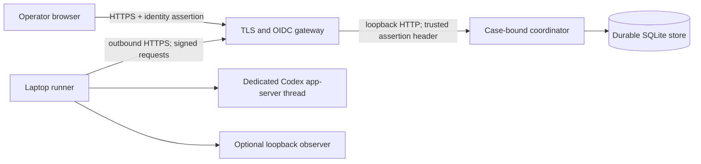

# Remote cockpit bridge

The remote cockpit bridge makes the progress-first cockpit reachable through an authenticated HTTPS origin while GATE and Codex continue to run on the operator's laptop. It is a separate deployment path from both the public GitHub Pages preview and the loopback-only local companion.

The repository contains the coordinator, browser adapter, durable protocol store, and outbound runner. That code does not make the published Pages site live by itself. A working deployment still needs an always-on coordinator host, a public HTTPS origin, an identity gateway, durable storage, an enrolled runner key, and a laptop runner with a working Codex login.

## What each surface is

| Surface | Where it runs | Interactive | Runtime connection |
| --- | --- | --- | --- |
| Public Pages preview | GitHub Pages | No | Checked-in example data only |
| Local companion | Operator laptop, loopback only | Yes | One dedicated local Codex app-server thread |
| Remote cockpit | Authenticated HTTPS coordinator plus an outbound laptop runner | Yes | One dedicated Codex app-server thread owned by that runner |

The remote runner does not attach to this Codex cloud conversation, an arbitrary Codex Desktop conversation, or a hidden existing thread. Starting it creates or resumes a separately configured dedicated app-server thread. The browser can send bounded messages and answer native choice questions in that thread. It receives the operator-visible conversation, categorical activity, bounded fleet state, and token counters that the runner is allowed to project.

GitHub Pages remains an explicit `PREVIEW · NOT LIVE` build. It publishes only the static allowlist documented in [Public snapshot integration](local-companion.md#public-snapshot-integration). The remote browser adapter and every coordinator or runner module stay out of that artifact.

## Architecture



The browser never receives a runner private key, provider token, OIDC client secret, Codex credential, or internal thread identifier. The coordinator never opens an inbound connection to the laptop. The laptop runner polls the coordinator over outbound HTTPS, leases one command, records it in an owner-only deduplication journal before dispatch, reports its lifecycle, and uploads bounded projections.

The first release binds one coordinator instance and one runner to one operator subject, one case ID, and one positive session revision. Run concurrent cases as separate instances with separate databases, journal directories, runner keys, HTTPS hostnames, and dedicated Codex working directories or checkouts. A hostname boundary also prevents the fixed secure session cookie from colliding between instances. The underlying store keys records by case, but the current server and runner configurations deliberately accept only one case binding per process.

Those boundaries separate protocol identity, durable state, retries, and model-thread context. They do not create filesystem, process, credential, kernel, or operating-system isolation. A separate working directory reduces accidental cross-case context, but another process under the same laptop account can still reach anything that account can reach, and the read-only Codex sandbox is not a confidentiality boundary. Use a separate operating-system account or a separate VM for each case when cases must be confidential from one another.

## Browser and operator identity

Put the coordinator behind a TLS-terminating, identity-aware reverse proxy. The proxy must:

- authenticate the operator on browser routes and inject the configured assertion header only after that authentication;
- remove any assertion header supplied by a public client before applying the route-specific behavior below;
- preserve the exact public `Host` and report `X-Forwarded-Proto: https` on the loopback hop;
- expose one exact HTTPS origin with no path prefix;
- avoid caching cockpit, API, and event-stream responses;
- forward server-sent events without buffering.

Configure the gateway by exact route class. Do not apply one global interactive-OIDC rule to the whole hostname: the laptop runner has no browser login session and authenticates itself with its signed request.

| Path | Gateway authentication and header behavior | Exposure rule |
| --- | --- | --- |
| `/`, `/index.html`, `/assets/*`, `/remote/client.js`, `/data/status.json`, `/robots.txt`, `/.nojekyll`, `/api/cockpit/v1/*` | Require the operator's interactive OIDC session. Remove every client-supplied copy of the configured identity assertion header, then inject one current provider-signed JWT for the authenticated operator. | Browser only. Disable caching; disable buffering and extend streaming timeouts for `/api/cockpit/v1/events`. |
| `/api/runner/v1/*` | Do not require or redirect to interactive OIDC. Remove the identity assertion header and do not inject one. Preserve the request method, exact origin-form path, body bytes, and `X-GATE-Runner`, `X-GATE-Timestamp`, `X-GATE-Nonce`, `X-GATE-Body-SHA256`, and `X-GATE-Signature` headers; the coordinator verifies their Ed25519 signature. | Laptop runner only over HTTPS. Do not expose any unsigned bypass or service-token substitute. |
| `/healthz`, `/readyz` | No OIDC assertion is needed because the coordinator returns only bounded health state. | Keep on the host or a private platform-health network. Do not route these paths from the public hostname. |
| Every other path | None. | Deny at the gateway. |

For every proxied browser or runner request, preserve the exact public `Host`, set `X-Forwarded-Proto: https`, keep the path unchanged, and send it only to the configured loopback listener. A provider-specific gateway configuration is still required; the table above is the contract that configuration must implement.

Apply gateway rate and abuse controls separately to the browser and runner route classes before requests reach Node. Invalid or unsigned runner traffic must not consume the authenticated browser allowance or the allowance reserved for the enrolled runner. The coordinator also keeps independent windows for public/static requests, authenticated browser requests, and signature-verified runner requests, but those post-authentication windows do not replace edge controls against volumetric traffic or repeated signature-verification work.

The coordinator validates the assertion itself against an exact issuer, audience, immutable operator subject, the reviewed `RS256` or `ES256` algorithms, and a public HTTPS JWKS endpoint. It does not accept an arbitrary email or display name as the identity binding. Browser sessions use a random `__Host-gate-session` cookie with `Secure`, `HttpOnly`, `SameSite=Strict`, and `Path=/`. Every page bootstrap or refresh must present a fresh proxy-injected assertion and `Sec-Fetch-Site: same-origin` to the session endpoint; the cookie alone is insufficient. Writes also require the session's in-memory CSRF value, the exact `Origin`, and a same-origin fetch context.

Do not expose the coordinator directly on a public bind. Its Node server speaks HTTP and is intended to bind to loopback behind the gateway. Health endpoints reveal only service readiness and should be limited to the host or platform health checker.

## Runner identity and command delivery

Enroll one Ed25519 public key in the coordinator and keep its private key in an owner-only file on the laptop. Every runner request signs the protocol version, runner ID, HTTP method, exact path, timestamp, nonce, and SHA-256 of the body. The coordinator enforces the configured clock-skew window and one-time nonce use. TLS is still required; signatures authenticate the runner and bind the request but do not provide transport confidentiality.

Commands are durable and case-bound. Request IDs are idempotent within the exact operator subject, case ID, and session revision rather than the ephemeral browser-cookie session: after a refresh, retrying the same ID and payload returns the original receipt, while changing the payload is a conflict. The browser keeps a bounded tab-session retry index containing only that case and revision, request IDs, question tokens, and SHA-256 payload digests; operator messages and answer text are never written to browser storage. The refreshed session can therefore recover the original ID when the operator retries the same payload, while a different case or revision cannot reuse it. The refreshed session can also replay that scope's existing lifecycle events. The original browser-session ID remains recorded as command provenance, but it is neither the deduplication key nor an event-visibility boundary. Every refresh still verifies a fresh OIDC assertion, revokes the replaced page session, and issues a new CSRF proof. The browser receives a queued receipt rather than a claim that Codex completed the work. The runner reports `accepted`, `running`, and a terminal `completed` or `failed` command transition. Here, `completed` means the local `CodexCompanionAdapter` accepted the message, steer, or question response; it does not mean the Codex turn finished. Turn progress and the final visible reply arrive separately through state and activity projections. A `running` command whose lease is abandoned becomes `failed`; its delivery outcome is unknown and the coordinator never dispatches it again. Expiry, lease identity, payload digests, session revision, and the runner's owner-only journal prevent an old or replayed command from being silently dispatched as new work. Rotating the session revision invalidates stale browser and runner state.

The remote runner pins Codex app-server thread creation and resume to approval policy `never` and sandbox mode `read-only`, verifies that app-server reports those effective settings, and pins every new turn to the equivalent read-only policy with network and environment access disabled. It will not attach remote steering to a turn that was already active when the thread was resumed because that turn's original posture cannot be proven. Thread creation supplies empty dynamic-tool, selected-capability-root, and environment lists. The app-server process receives fixed flags that disable apps, plug-ins, hooks, browser and computer use, code mode, image generation, memories and history-notes tooling, both multi-agent implementations, tool suggestion, web search, and orchestrator MCP, and it replaces the legacy out-of-sandbox `notify` command with an empty list. Before any thread is created or resumed, the adapter reads the effective configuration for the selected checkout and fails closed unless every fixed disable is effective, legacy `notify` is empty, and the MCP server map is empty.

The loopback local companion keeps its normal locally configured posture. The remote child receives only a small operating-system, path, locale, home, and Codex-home environment allowlist; ambient API keys, repository tokens, proxy credentials, runner configuration, and language-loader variables are omitted. It uses a required owner-only Codex home directly under that case's runner journal instead of inheriting the interactive Codex home. Authenticate that dedicated home explicitly; environment-only API keys are intentionally unavailable.

This posture limits host command, filesystem mutation, and configured external tool calls; it is not a confidentiality boundary. Codex can still read files allowed by its read-only sandbox and can place derived text in a final reply. Model requests and the signed coordinator polling connection still require their documented network paths. A same-user process that rewrites the dedicated Codex home, project configuration, runner code, or checkout while the runner is active remains inside the laptop trust boundary.

The runner needs:

- outbound HTTPS access to the exact coordinator origin;
- Node.js 22.20 or newer, exact Codex CLI/app-server `0.159.2`, and a working login in the case's dedicated remote Codex home;
- the GATE checkout and a dedicated Codex working directory or checkout for this case;
- one case ID, runner ID, and session revision matching the coordinator;
- an owner-only Ed25519 private-key file and owner-only journal directory;
- optional access to the loopback observer when fleet projection is wanted.

Keep the runner on the laptop that is meant to perform the work. The remote bridge does not move target tools, browser sessions, local evidence, or host capabilities into the coordinator.

## Data boundary

The coordinator persists only the remote protocol's bounded records:

- operator messages and choice answers accepted into the command queue;
- command digests, leases, lifecycle events, expiry, and idempotency identifiers;
- bounded operator-visible messages and final Codex replies;
- bounded native choice questions;
- categorical activity, bounded fleet state, and aggregate token counters;
- case, operator-subject, runner, browser-session, and session-revision bindings.

Resumed threads use the companion's [bounded conversation restoration](local-companion.md#start-it). The remote projection further bounds each message to 1,000 Unicode characters, 2,000 UTF-8 bytes, and 24 lines, adding an explicit truncation notice. It also marks omitted earlier entries. Questions whose headers, text, or options exceed the remote display contract are withheld as a whole, preserving answer identity; the conversation directs the operator to answer locally. When Codex is waiting without a displayable question, the cockpit shows `Open laptop`.

Automatic fleet and activity projections, and the structural fields of the state projection, do not carry hidden reasoning, system or developer instructions, command lines, arguments, stdout or stderr, file paths, raw evidence, dedicated target fields, credentials, internal Codex thread IDs, or arbitrary observer responses. Operator messages, final visible replies, and rendered native questions are different: they can contain URLs, project context, target names, or a described command, and the coordinator stores their bounded text. Pattern filtering rejects common credential assignments, authorization headers, private-key markers, credential-bearing URLs, and several standalone token families from remote messages, answers, questions, and mirrored conversation text. It is not an exhaustive secret or target-data scanner. Treat the coordinator database as sensitive operator data, keep it on an encrypted persistent volume with owner-only access, and apply a deliberate backup and retention policy. Do not send credentials, raw evidence, or unnecessary exact target details through the remote conversation.

Raw captures, reports, tool output, client material, exact target state, and other private operational evidence remain under `GATE_HOME` on the laptop. The remote projection does not replace the repository's data policy, case binding, engagement receipts, or execution adapters, and a browser message does not itself grant active-operation authority.

## Deployment prerequisites

Prepare these before calling the bridge live:

1. An always-on Linux host with Node.js 22.20 or newer and persistent local storage. The runtime must include `node:sqlite`.
2. A dedicated DNS name and valid TLS certificate for each concurrently open case instance.
3. An identity-aware reverse proxy and an OIDC provider that can supply an `RS256`- or `ES256`-signed assertion with a stable subject. Record the exact issuer, audience, subject, JWKS URL, and private assertion-header name.
4. An owner-only coordinator configuration, SQLite database directory, and runner public-key enrollment. Do not put private keys or OIDC client secrets in Git or an image.
5. An Ed25519 runner keypair generated on the laptop. Transfer only the public key to the coordinator and keep the private key owner-only.
6. A laptop runner with a dedicated owner-only Codex home directly under its owner-only journal, Codex authenticated in that home, the exact public HTTPS coordinator origin, and matching case/session bindings.
7. Host monitoring for `/healthz` and `/readyz`, durable-volume backup, disk exhaustion, certificate expiry, runner heartbeat loss, and service restart.

Use separate operating-system identities or machines for the coordinator and its reverse proxy when practical. The proxy is trusted to authenticate the browser and protect the assertion header. The coordinator host is trusted with queued operator text, final visible replies, and bounded operational projections. The laptop remains trusted with Codex credentials, GATE private state, tools, and evidence.

## Configuration and entrypoints

The coordinator accepts one absolute, owner-only JSON configuration through `--config` or `GATE_REMOTE_CONFIG`. It contains the exact public origin, loopback host and port, operator/case/session binding, absolute SQLite path, OIDC verifier settings, assertion-header name, and one runner ID/public-key path. The key file, database, config, and their parent state directories must be owner-only. Start it with:

```bash
npm run cockpit:remote:server -- --config /absolute/private/server.json
```

The laptop runner accepts the coordinator origin, case/session/runner binding, private-key path, journal directory, dedicated Codex home, and thread-record path as flags or `GATE_REMOTE_*` environment variables. The Codex home must be an existing owner-only directory directly under the journal. The optional `GATE_REPO` selects the dedicated thread's working directory and `GATE_OBSERVER_URL` selects the exact loopback fleet endpoint. Give each concurrent case its own `GATE_REPO` directory or checkout even when the source revision is the same. Create and authenticate the dedicated home, then start the runner after loading the owner-only configuration:

```bash
runner_state="$HOME/.local/share/gate/remote/example-case"
remote_codex_home="$runner_state/codex-home"
install -d -m 0700 "$runner_state" "$remote_codex_home"
npm install --global --prefix "$HOME/.local" @openai/codex@0.159.2
export PATH="$HOME/.local/bin:/usr/local/bin:$PATH"
test "$(codex --version)" = "codex-cli 0.159.2"
CODEX_HOME="$remote_codex_home" codex login
CODEX_HOME="$remote_codex_home" codex login status

# Set GATE_REMOTE_CODEX_HOME=$remote_codex_home in the owner-only runner environment.
npm run cockpit:remote:runner
```

The supplied runner entrypoint is operator-attended and foreground-only. Closing its terminal, ending the login or WSL session, shutting down WSL, sleeping or rebooting the laptop, or losing network access stops live steering. The coordinator may remain reachable, but its runner and projections must become stale or unavailable. After the laptop and network return, load the same owner-only runner environment and run the same command; the journal and boundary-bound thread record are designed to resume the existing runner state. Check the cockpit for an ambiguous or failed command before retrying it.

This release does not include a laptop runner service. Do not wrap it in an unconditional restart loop: a permanent identity, signature, session-revision, boundary, or configuration rejection is supposed to stop instead of retrying forever. A later host-specific service must preserve the exact environment and state ownership, stop cleanly, distinguish permanent from transient exits, and never run two processes against one journal.

The exact non-secret shapes, key-generation steps, and optional hardened systemd coordinator unit are under [`deploy/remote`](../deploy/remote/README.md). They are templates rather than a deployment: every example identity, host, path, and case must be replaced, and the chosen identity gateway still requires its provider-specific configuration.

## Readiness check

A deployment is ready only when all of these are observed:

- the external browser reaches the exact HTTPS origin through the identity gateway;
- the authenticated browser can load `/data/status.json` without a redirect or gateway denial;
- the browser receives a secure session only for the configured immutable subject;
- `/readyz` reports ready from the platform health path;
- a request receives a durable `queued` receipt, its dispatch lifecycle reaches a terminal state, and the separate state/activity stream later shows the expected Codex turn result;
- the enrolled runner is visible as current, not stale or offline;
- state expires when runner updates stop instead of remaining falsely live;
- restarting the coordinator preserves queued state and restarting the runner preserves its deduplication journal;
- the runner rejects an ambient Codex home and stops before thread creation when effective MCP or external-tool configuration is present;
- sustained unsigned runner requests are limited at the gateway without spending the coordinator budgets for the authenticated browser or enrolled runner;
- the public Pages artifact still contains only the static allowlist.

Until those checks pass on an actual host, describe the remote cockpit as deployable code rather than a live bridge. Neither this repository nor ChatGPT Sites supplies the always-on coordinator, DNS, TLS, identity gateway, persistent volume, or laptop runner automatically.

## Recovery and rotation

Stop the runner before changing its case, key, session revision, dedicated Codex home, pinned app-server version, or remote boundary revision. Preserve its journal until every accepted command is terminal or deliberately retired. The runner holds an instance lock in its journal directory; after an unclean exit, verify that no runner process still owns the directory before removing only the proven-stale lock. The v3 thread record is written as `creating` immediately before thread creation, `provisional` after a valid start response, and `used` immediately before the first turn request. Only `used` resumes. An intentional clean stop removes a never-used provisional record after app-server closes; a `creating` or `provisional` record found at startup remains ambiguous and must stop. A failed `used` resume also stops rather than creating a replacement. Preserve and reconcile ambiguous or pre-v3 records, configure a new unused thread-record filename directly under the journal only after that decision, and let the runner create a fresh boundary-bound thread. Rotate a compromised runner key by removing the old public key from the coordinator, enrolling a new key, incrementing the session revision, and starting a fresh owner-only journal binding. Revoke browser sessions by restarting coordinator session state and require the identity gateway to issue a new assertion.

If coordinator state is lost, do not infer that a command failed or can safely be replayed. Compare the surviving runner journal and Codex thread state, record the ambiguity, increment the session revision, and issue a new request only after deciding whether repeating the action is safe. A stale projection, missing runner, signature error, storage error, or session mismatch must remain visible as unavailable or failed rather than being converted to success.
